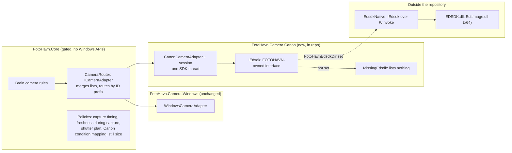

# Canon EOS cameras through EDSDK beside the webcam

FOTOHAVN adds a second camera adapter. It drives Canon EOS cameras over USB through Canon's EOS Digital Camera SDK (EDSDK), with the EOS R100 as the supported body, beside the webcam adapter of [ADR 0004](0004-brain-owned-webcam-through-one-exclusive-mediacapture-stream.md). The brain keeps every camera rule. The camera port learns one new fact, that a camera can be a **still camera**: its preview is a live-view stream, and its Captures are real photographs that arrive a moment after the shutter fires.

Amends: ADR 0004 and plan decision D5, which deferred Canon EDSDK and said a vendor integration needs its own adapter and its own ADR. This is that ADR. ADR 0004 keeps governing webcams unchanged.

## Context

- **The R100 has no other path.** It doesn't support USB Video Class, so Windows `MediaCapture` never lists it. EDSDK over wired USB is the only Canon-documented path to live view, remote shutter, and image transfer for the R100 ([`canon-eos-r100-windows.md`](../research/canon-eos-r100-windows.md)).
- **Industry practice matches.** LumaBooth for Windows (formerly dslrBooth) supports the R100 from version 7, over USB only. Open-source photobooths use the same SDK pattern: one SDK thread, save to host, a live-view loop, and download on the camera's transfer request ([`edsdk-photobooth-integrations.md`](../research/edsdk-photobooth-integrations.md)).
- **The SDK is in hand.** The owner holds EDSDK 13.20.21 for Windows, with x64 DLLs and an API reference that lists the R100 for camera control (added in 13.17.0).
- **The repository is public.** Canon's terms allow object code to be distributed only inside FOTOHAVN and forbid disclosing confidential SDK information. No SDK binary, header, sample, or binding derived from them may enter git.
- **The camera port assumes a video stream.** `ICameraSession.CaptureAsync` returns the first stream frame after the countdown. The brain flashes when that frame is in hand and treats frames older than 2 s as a failure.
  - A still camera needs a separate exposure moment and delivery moment. A webcam frame is in hand within milliseconds. An R100 photograph exists only after autofocus, the shutter, and a USB 2.0 transfer of several megabytes.
  - Its live view also pauses while it takes the picture.
- **Booth rules don't change.** The 2 s freshness rule, the first-fresh-frame rule, Operator Assistance, Retry, and the mirror rule (D22) are domain rules. A still camera must satisfy them, not bypass them.

| | Webcam (ADR 0004) | Canon EOS through EDSDK (this ADR) |
| --- | --- | --- |
| Discovery | `DeviceWatcher` on video-capture devices | The SDK's camera list, re-read on SDK hot-plug and Windows device notifications |
| Identity | Windows device ID | The SDK's port name for the camera, prefixed `edsdk:` |
| Preview | The video stream, 1920×1080 or a fallback | Live-view JPEG frames pulled one at a time (size and rate measured in spike S6) |
| Capture source | A frame of the same stream | A real still photograph, saved to the host only |
| Capture timing | Immediate | Shutter command, AF and exposure, then transfer |
| Live view during capture | Continuous | Pauses during exposure and transfer |
| Failure signals | `MediaCapture.Failed`, removal, staleness | SDK error results, the shutdown event, the capture-error event, staleness |

## Decision

### Scope

- v1 supports webcams (ADR 0004) and Canon EOS cameras that EDSDK controls over USB. **The EOS R100 is the only tested and supported body.** Other EDSDK cameras appear in the camera list and may work, but they are untested, and the operator documentation says so.
- Wi-Fi, CCAPI, EOS Utility, EOS Webcam Utility, and HDMI capture are out of scope (see Considered options).
- The Event setup, Camera Binding, eligibility, Start Event, Operator Assistance, and Retry rules in [`app/CONTEXT.md`](../../CONTEXT.md) apply unchanged. Only their camera wording broadens (see On acceptance).

### Projects and placement



- **`CameraRouter`** in `FotoHavn.Core` implements `ICameraAdapter` over several adapters. It concatenates their lists (webcams first, in each adapter's own order), raises `CamerasChanged` when any of them does, and routes `OpenAsync` by device ID prefix. It holds no hardware code, so it is unit-tested under the 90% gate. The host constructs it from the webcam adapter and the Canon adapter. `FaultInjectingCameraAdapter` wraps the router, so fault hooks cover both kinds.
- **`FotoHavn.Camera.Canon`** is the thin adapter. It owns the SDK thread, translates SDK facts into port facts, and does only I/O. Like `FotoHavn.Camera.Windows`, it is excluded from the coverage gate and proven by hardware and end-to-end tests. Its state machine also gets unit tests against a fake `IEdsdk`.
- **`IEdsdk`** is a narrow interface written in FOTOHAVN terms, with about fifteen operations:
  - initialize and terminate the SDK;
  - list cameras;
  - open and close a session;
  - read identity, battery, and shooting mode;
  - configure save-to-host and capacity;
  - set image quality;
  - disable auto power-off;
  - start and stop live view, and download one live-view frame;
  - press the shutter in stages;
  - download or cancel a transfer;
  - pump events.

  SDK error codes cross it as a FOTOHAVN-owned `EdsdkCondition` value (`Busy`, `NotReady`, `NotFound`, `InUse`, `Disconnected`, `FocusFailed`, `CardProblem`, `WrongMode`, `Internal`, `Other`), never as Canon's numbers.
- **`EdsdkNative`** implements `IEdsdk` with P/Invoke. It holds the function signatures, constants, structures, and the raw-code-to-`EdsdkCondition` table, all derived from Canon's headers. It lives **outside this repository**, together with the DLLs. MSBuild compiles it into `FotoHavn.Camera.Canon` only when `-p:FotoHavnEdsdkDir=<folder>` (or the `FOTOHAVN_EDSDK_DIR` environment variable) points at it. Without it, `MissingEdsdk` lists no cameras and logs once that the Canon SDK isn't in this build. CI, contributors, and the headless host build and test without the SDK.

### Camera port changes

The brain stays vendor-neutral. It learns only that a camera can be a still camera.

```csharp
public enum CameraKind { VideoStream, StillCamera }

public sealed record AvailableCamera(string DeviceId, string Name, CameraKind Kind);

public interface ICameraSession : IAsyncDisposable
{
    CameraKind Kind { get; }
    // DeviceId, Format, Now, LatestFrame, Failed, and SetPreviewTarget are unchanged.

    /// <summary>Called by the brain when one countdown second is left. A still camera starts autofocus; a webcam does nothing.</summary>
    void PrepareCapture();

    /// <summary>Replaces CaptureAsync. Exposed completes when the photograph is taken (the flash); Frame completes with the full-size BGRA8 image.</summary>
    CameraCapture Capture(TimeSpan notBefore, CancellationToken cancellationToken);
}

public sealed record CameraCapture(Task Exposed, Task<CapturedFrame> Frame);
```

- **Webcam.** `Exposed` and `Frame` complete together, with the frame chosen exactly as today. ADR 0004 behavior doesn't change.
- **Flash and steps.** The brain moves the flash (`FrameTaken`, `SequenceStep.Saving`) from "frame in hand" to `Exposed`. Mirroring, JPEG encoding, and the commit still start from `Frame`. A Capture still belongs to the Guest Cycle only once it is committed.
- **Timeouts.** These become a `CaptureTimingPolicy` per `CameraKind`.
  - Webcam: one 10 s limit, as today.
  - Still camera: `Exposed` within 5 s of the command, and `Frame` within 15 s of `Exposed`.

  Missing either deadline is a camera failure. These values are proposed and get tuned in spike S6.
- **`notBefore`.** A still camera satisfies it trivially, because the exposure happens after the command. `CapturedFrame.Timestamp` is the moment `Exposed` completed, on the session clock.
- **Freshness during capture.** `FrameFreshness` gains a rule for still cameras: staleness is suspended from `Capture` until `Frame` completes or fails, and for a 2 s grace afterwards while live view resumes. The suspension is bounded by the capture deadlines above, so a dead camera still fails. Outside that window the 2 s rule applies unchanged, and eligibility, Start Event, and Retry still require a fresh live-view frame.
- **Format.** `ICameraSession.Format` reports the live-view frame size, with subtype `JPEG-EVF` and the measured rate. Camera diagnostics also show the still size the session configured.

### The SDK thread

- One dedicated thread lives for the app's lifetime. It initializes COM as a single-threaded apartment, as Canon's API reference requires for non-main threads, then initializes the SDK once. It makes **every** SDK call. It terminates the SDK once at app exit, after closing any session.
- It runs one loop: run queued work, then pump SDK events, then pull one live-view frame when live view is on and the previous frame has been handed off.
  - SDK events are pumped by polling, as Canon's console sample does on Windows. A Windows message pump on the same thread is added only if spike S6 shows callbacks need one.
  - Event callbacks run on this thread, because it opened the session. They only record facts and post them to the adapter.
- Native handles never leave the thread. The rest of the adapter sees camera IDs, byte arrays, and facts.
- A command answered "busy" is retried after 500 ms, as Canon's sample advises, up to a bounded count. A `CameraRetryPolicy` extension in Core sets the bound.
- One camera session at a time, which matches decision Q19.

### Discovery and identity

- The adapter lists cameras from the SDK's camera list and reads each camera's device information without opening a session. The device ID is `edsdk:` plus the SDK's port name, and the name is the SDK's device description, such as "Canon EOS R100".
- It re-lists on the SDK's camera-added event, on a session's shutdown event, and on Windows device arrival or removal for Canon USB devices. A Windows `DeviceWatcher` provides those, and the router turns them into `CamerasChanged`.
- The Camera Binding stores the `edsdk:` ID, and matching is exact, as for webcams. A camera moved to another USB port may need to be re-chosen, which is the same consequence ADR 0004 accepts. Spike S6 checks whether the port name is stable across replugging and power cycles on the same port. If it isn't, identity moves to the body serial number read after opening, with the port name as a lookup.

### Opening and readiness

Opening an R100 does the following in order. Any failure is a `CameraException` with a classified kind.

1. Open a session. If another program holds the camera, such as EOS Utility, the result is `InUseByAnotherApp`.
2. Read the model, body serial, firmware, battery level, and shooting mode, and log them.
3. Reject a camera whose mode dial is in a movie mode with `CameraSettings` (a new kind; see Failure classification).
4. Disable the camera's auto power-off through the SDK; the API reference supports this on R-series bodies other than the EOS R and RP. Also answer every "will soon shut down" event by extending the timer.
5. Set the save destination to the host, declare free host capacity, and set image quality to the still size the `StillSizePolicy` chooses (below).
6. Start live view routed to the PC only. The camera's own controls lock except SET, so guests can't change settings on the body.

`OpenAsync` completes after step 6. The camera becomes Eligible exactly as ADR 0004 defines it: when a fresh live-view frame arrives. A camera that delivers no frame within the existing 2 s is `Stale`.

### Live view

- The SDK thread pulls one live-view JPEG at a time. A "not ready" answer is skipped, not treated as a failure; only the 2 s freshness rule decides staleness.
- A worker thread decodes each JPEG to BGRA. The frame then enters the existing pipeline unchanged: `PreviewScaler` (at most 1280 px wide, never upscaled), the shared-buffer channel, one frame in flight, and drops under back-pressure (ADR 0004, Spike S1).
- `LatestFrame` is stamped on arrival on the session's monotonic clock.
- The pull rate is capped at 30 Hz. The end-to-end frame-rate floor for still cameras is set from the S6 measurement, and stays at 15 fps if the R100 sustains it over USB 2.0.

### Capture

- **Shutter plan** (a `StillShutterPlan` policy in Core):
  1. With one countdown second left, the brain calls `PrepareCapture`, which half-presses the shutter so autofocus runs before zero.
  2. At zero, a full press, then release.
  3. If focus fails, the plan releases the button and tries once more with the no-AF half and full presses. A slightly soft photograph is better than a missed one.

  The API reference forbids mixing AF and no-AF stages within one press, so each attempt uses one family. A second failure is a camera failure.
- **Transfer.** When the camera raises its transfer request, the adapter downloads the image to memory and marks the transfer complete.
  - The adapter decodes the image, applying EXIF orientation so a camera mounted in portrait gives an upright image, and completes `Frame` with BGRA8.
  - From there the brain's existing path runs unchanged: mirror per the Event (D22), JPEG at quality 92 with no metadata, then commit. FOTOHAVN stores its own JPEG, never the camera's file, so mirroring, metadata stripping, and storage stay the same for both camera kinds.
- **Unasked transfers.** A transfer request with no capture outstanding, for example from someone pressing the body's shutter, is cancelled and logged. Saving to the host keeps it off the card, so nothing accumulates.
- **Still size.** `StillSizePolicy` chooses the smallest R100 JPEG size at least 2400 px wide: S1 Fine, about 2976×1984, to be confirmed in S6. That is about three times the webcam's pixels, and it bounds decode, re-encode, memory, and composition time. Spike S3's composition budget (150 ms median) is re-measured with 3:2 S1 inputs.
- **Recovery.** If the camera disconnects or a deadline passes after `Exposed` but before `Frame`, the photograph is lost, because it was saved to the host only. The Guest Cycle enters Operator Assistance, and after `RETRY` that window's photograph is taken again. This is the same rule as any Capture that never committed.

### Failure classification

`CanonFailureClassifier` in Core maps `EdsdkCondition` and the SDK's state events to `CameraFailureKind`. It is unit-tested.

| SDK fact | During open | During a session |
| --- | --- | --- |
| Session refused because another program holds the camera | `InUseByAnotherApp` | — |
| Camera not found, disconnected, or shutdown event | `NotFound` | `Removed` |
| Busy | Retried; `Unknown` when retries run out | Retried; `Failed` when retries run out |
| Focus failed twice | — | `Failed` (capture) |
| Card missing, card error, or write-protected (only if the body insists on a card while saving to the host) | `CameraSettings` | `CameraSettings` |
| Movie mode, no lens, or sensor cleaning | `CameraSettings` | `CameraSettings` |
| SDK internal-error event | `Unknown` | `Failed`; the session is closed |
| Anything else | `Unknown` | `Failed` |

- **New kind: `CameraSettings`.** The camera is connected but its own settings or hardware prevent a photograph. The detail names the cause in the log.
- **UI copy.** The operator sees "Check the camera's mode dial, lens, and card." The guest sees the existing Operator Assistance copy. This changes the protocol: the wire value, a version bump, generated TypeScript types, and UI copy written from [`brand/voice.md`](../../../brand/voice.md).
- **Retry.** `CameraRetryPolicy` treats `CameraSettings` as retryable, because the operator fixes the camera, then retries.

### Power and camera setup

- **Power.** The field rig uses the AC-E6N adapter with the DR-E18 DC coupler. USB doesn't power the R100. Camera diagnostics show the battery level for information only.
- **Operator checklist** in [`local-development-guide.md`](../local-development-guide.md), adapted from LumaBooth's guidance:
  - Wi-Fi and Bluetooth off.
  - Manual or Program exposure, single-shot drive, one-shot AF.
  - JPEG only.
  - Exposure simulation off when using flash.
  - A formatted card inserted.
  - EOS Utility closed and EOS Webcam Utility not installed.
  - On AMD Ryzen laptops, a USB 2.0 hub between camera and laptop if transfers stall after the first photo.
- **What the app enforces.** It checks what it can read, the shooting mode, and enforces what it can set: save to host, capacity, still size, and auto power-off. The checklist covers the rest.

### SDK packaging and licensing

- **Nothing from Canon's package enters git:** no DLLs, headers, documentation, samples, or bindings derived from them. `.gitignore` gains the conventional drop folders, and a contract test fails if `EDSDK.dll`, `EdsImage.dll`, `EDSDK.h`, or `EDSDKTypes.h` appear anywhere in the tree.
- **`EdsdkNative` and the x64 DLLs live in a private location the owner controls.** The proposed default is a private repository, checked out beside this one and referenced by `FotoHavnEdsdkDir`.
- **The field build.** `publish-field-test.ps1` takes `-EdsdkDir`. It verifies the pinned x64 DLLs by SHA-256 and copies them next to the executable. It refuses a mismatch, as it does for the WebView2 cab (Spike S4). The pins are:
  - `EDSDK.dll` 13.20.20.6402, SHA-256 `52DF43AF1AE133B7F07AC8DE1D3657C3E7CB03A01B6B508EFCE95192BFE4AD17`;
  - `EdsImage.dll` 3.19.0.6400, SHA-256 `39AF9D48E2FF693A98CE9920B7BD103DCCC37900385BC455921B7B40DDE703FB`.

  Publishing these hashes discloses nothing confidential.
- **Builds without the SDK.** A field build without `-EdsdkDir` is a webcam-only build. Its manifest says so, so nobody ships a Canon booth without Canon support by accident.
- **Notices.** The field build's notices file states that the software is based in part on the work of the Independent JPEG Group, as the SDK's readme requires of distributors.
- **Upgrades.** Moving to a new SDK version means updating `EdsdkNative`, the pins, and the S6 hardware checks together.
- **Licence check before the first field build.** Confirm that the accepted Canon agreement covers FOTOHAVN's country and redistribution of these two DLLs ([`canon-eos-r100-windows.md`](../research/canon-eos-r100-windows.md#sdk-acquisition-license-and-redistribution)).

### Testing (ADR 0007)

- **Core.** `CameraRouter`, `CaptureTimingPolicy`, the still-camera freshness rule, `StillShutterPlan`, `StillSizePolicy`, `CanonFailureClassifier`, and the brain's two-phase capture all get unit tests first, under the 90% gate.
- **Fake camera.** `FakeCameraAdapter` gains a still-camera mode with:
  - a live-view pattern that pauses during capture;
  - a configurable exposure delay and transfer delay;
  - a focus failure;
  - an unasked transfer;
  - a disconnect between exposure and transfer.

  Brain, headless, and fixture tests use it, so every new branch is proven without hardware.
- **Adapter.** `FotoHavn.Camera.Canon.Tests` covers the adapter's state machine against a fake `IEdsdk`. Hardware tests with a real R100 and the SDK are reported "not run: no Canon camera or SDK" when either is missing.
- **End to end.**
  - The E2E build includes the SDK when `FotoHavnEdsdkDir` is set. `FOTOHAVN_E2E_CAMERA` can choose the R100.
  - A `@canon` tag marks the camera-live, capture, fault, and composition specs that must also pass with the R100. They run on the booth laptop before every Canon field build.
  - The webcam end-to-end runs stay as they are.

### Spike S6, before implementation

On the booth laptop with the R100, a fixed USB cable, the AC coupler, and SDK 13.20.21, run the on-rig proof list in [`canon-eos-r100-windows.md`](../research/canon-eos-r100-windows.md#required-on-rig-proof-before-architecture-is-final), plus these checks:

1. Pumping events by polling on one STA thread is enough on Windows, with no message pump.
2. Live-view frame size, sustained rate, and latency over USB 2.0, through the shared-buffer preview.
3. Time from shutter command to `Exposed`, and from `Exposed` to `Frame`, at S1 Fine. How long live view pauses.
4. Half-press timing at one second left, and the focus-failure path in dim light.
5. Whether the R100 releases the shutter with no card while saving to the host.
6. Whether the port name is stable across replugging, camera power cycles, and Windows restarts.
7. Hot-unplug during idle, live view, half-press, exposure, and transfer. Recovery without restarting FOTOHAVN.
8. What happens when EOS Utility, Windows AutoPlay, or Photos import grabs the camera first.
9. Composition time with S1 inputs against the 150 ms budget.

S6 records its results in this ADR, as S1 did in ADR 0004. Any result that contradicts a decision above returns this ADR to proposed with the change.

## Considered options

- **EOS Webcam Utility, so the R100 appears as a webcam.** Rejected. Captures would be video frames, not photographs, and Canon's utility, not FOTOHAVN, would own the camera, with no shutter, transfer, or failure detail. It could serve as a stopgap only where Canon's utility supports the body, with ADR 0004 unchanged. It is not the target.
- **HDMI capture card.** Rejected for the same reason, video frames only, plus extra hardware.
- **CCAPI or Wi-Fi remote.** Rejected. The R100 can't use its USB interface while Wi-Fi is connected, and a booth needs the wired path's reliability.
- **gphoto2 or PTP through Windows WPD/WIA.** Rejected. Canon's live view and remote shutter are vendor extensions that these stacks don't reliably support on Windows. EDSDK is Canon's supported path, and the owner already holds a licence.
- **A separate camera-helper process.** It would isolate a native SDK crash from the booth, at the cost of moving live-view frames across processes. Deferred: v1 loads the x64 SDK in-process. If S6 or field use shows SDK crashes, a helper process implementing the same `IEdsdk` boundary is the next step, with no brain change.
- **Third-party wrappers** (EDSDK.NET, digiCamControl, napi-canon-cameras). Rejected as dependencies and used as references only. They embed Canon declarations in public code and don't fit the brain's port.
- **Keeping the single `CaptureAsync`.** Rejected. The flash would come one to two seconds after the real shutter, and the 2 s freshness rule would misfire during every transfer. Hiding both inside the adapter would put timing rules in an uncovered adapter, against [`app/AGENTS.md`](../../AGENTS.md).
- **Storing the camera's own JPEG.** Rejected for v1. It would bypass D22 mirroring and metadata stripping for one camera kind only. It can be revisited when a print path needs full-resolution originals.
- **Not mirroring still Captures.** The R100 research recommended mirroring only the preview. That conflicts with D22, which mirrors both the preview and saved Captures. This ADR keeps D22. Changing it is a product decision for the owner, not an adapter choice.

## Consequences

- **Capture quality.** A Canon Event gets real photographs, about 6 MP at S1. That is better optics and low-light quality than a webcam, at the cost of one to two seconds of transfer per Capture inside the existing 800 ms pause and capture step.
- **Two adapters, one rule set.** The brain gains a camera kind, a two-phase capture, and per-kind timing. Every rule stays in Core under the coverage gate. The webcam path is behavior-identical.
- **Protocol.** The protocol gains `CameraSettings` and a version bump, and Event setup and diagnostics gain copy for it.
- **Builds.** CI and contributors never need the SDK. Canon support exists only in builds made with `FotoHavnEdsdkDir`, and the field manifest states which kind of build it is.
- **Licence.** The owner keeps the Canon agreement in force and the private binding up to date.
- **Hardware testing.** Canon behavior can only be proven on the R100. Booth-laptop `@canon` runs join the field-build checklist (risk R6).
- **Risks.** An SDK crash ends the process until a helper process exists. A port-based binding may need re-choosing after moving the cable.

## Questions before acceptance

Each has a proposed default.

1. **Mirror (D22).** Should still Captures stay mirrored when the Event mirrors? Default: yes, keep D22 for both camera kinds.
2. **Still size.** Is S1 Fine (about 6 MP) right? Default: yes; revisit when printing arrives.
3. **Identity.** Should the binding use the port name, falling back to body serial only if S6 shows the port name is unstable? Default: yes.
4. **Card.** Save to host only, with a formatted card inserted as a requirement, unless S6 shows the R100 shoots without one. Default: yes.
5. **New failure kind.** Add `CameraSettings` with the operator copy above. Default: yes.
6. **Private binding location.** A private repository beside this one, referenced by `FotoHavnEdsdkDir`. Default: yes.
7. **Untested EDSDK bodies.** List them, marked untested in documentation, rather than hide them. Default: list them.

## On acceptance

- Set this ADR's status to `accepted`.
- In ADR 0004, note "Canon EOS cameras: see ADR 0009" under Context.
- Update [`implementation-plan.md`](../implementation-plan.md):
  - D5: webcams plus Canon EOS through EDSDK, R100 supported.
  - Section 3: scope.
  - Section 5: projects, the adapters box, and diagrams.
  - Section 11: camera.
  - Section 17: S6.
  - A new milestone for the Canon adapter after S6.
- Update [`app/CONTEXT.md`](../../CONTEXT.md):
  - Available Camera: "a Camera that Windows or the Canon SDK currently reports".
  - Eligible Camera: "a fresh preview frame" (a live-view frame for a still camera).
  - Add ADR 0009 to Decisions.
- Add ADR 0009 to `CONTEXT-MAP.md`, the `desktopAdrs` list in `scripts/agent-documentation-contract.test.mjs`, and the camera route in [`app/AGENTS.md`](../../AGENTS.md).
- Add the Canon camera checklist and the `FotoHavnEdsdkDir` build instructions to [`local-development-guide.md`](../local-development-guide.md).
