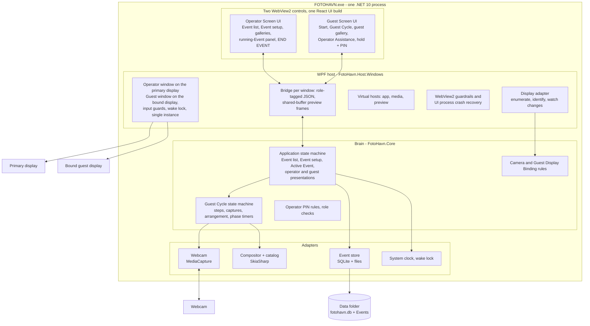
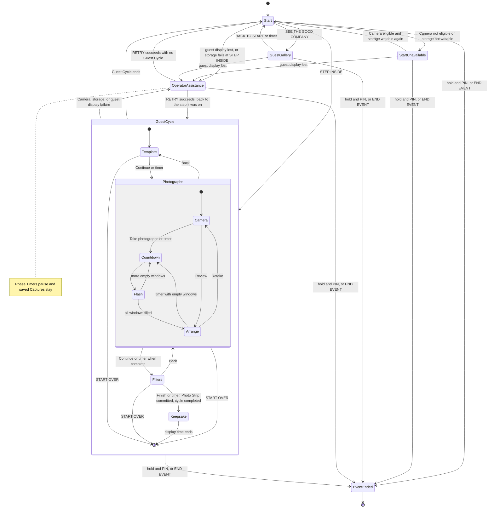
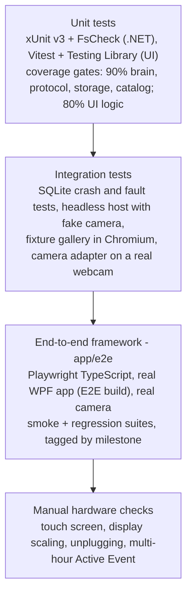
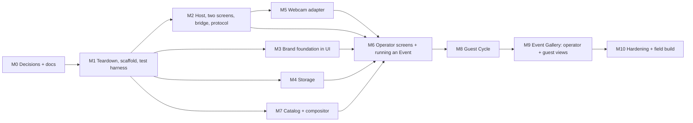

# FOTOHAVN desktop booth rebuild: implementation plan

Status: Draft for review
Date: 2026-10-13
Owner: `quinjan`

This plan replaces the current WinUI 3 desktop app with a new booth app: a React user interface hosted in WebView2 inside a WPF window, driven by a .NET brain that owns the camera, composition, storage, and every rule. The guest workflow follows the website's online booth. Version 1 supports webcams only and does not print.

This plan is a proposal and work tracker, not domain or design authority. When an item is built, its durable decision moves into an ADR, `app/CONTEXT.md`, or `app/DESIGN.md`.

## Contents

1. [Summary](#1-summary)
2. [Decisions](#2-decisions)
3. [Scope](#3-scope)
4. [Conflicts and resolutions](#4-conflicts-and-resolutions)
5. [Architecture](#5-architecture)
6. [Domain language](#6-domain-language)
7. [Guest Cycle specification](#7-guest-cycle-specification)
8. [Operator specification](#8-operator-specification)
9. [UI and brain protocol](#9-ui-and-brain-protocol)
10. [Storage](#10-storage)
11. [Camera and displays](#11-camera-and-displays)
12. [Catalog and composition](#12-catalog-and-composition)
13. [Design system interpretation](#13-design-system-interpretation)
14. [Testing and verification](#14-testing-and-verification)
15. [Repository changes](#15-repository-changes)
16. [Milestones](#16-milestones)
17. [Risks and spikes](#17-risks-and-spikes)
18. [Open questions](#18-open-questions)

## 1. Summary

| Item | Plan |
| --- | --- |
| UI | React 19 + TypeScript + Vite, CSS Modules, Phosphor Light icons, self-hosted Cormorant Garamond and Manrope |
| Host | .NET 10 WPF with two windows (Operator Screen and Guest Screen), each with one full-screen WebView2 control |
| Brain | .NET 10 class library with no Windows dependencies: Event setup, Active Event, Guest Cycle, timers, and rules |
| Adapters | Windows `MediaCapture` webcam, SQLite plus files for Event storage, SkiaSharp compositor, wake lock |
| UI contract | The brain pushes one presentation snapshot; the UI sends commands. JSON schema generated from C# records drives the TypeScript types |
| Design | New `app/DESIGN.md` interprets [`brand/`](../../brand/README.md), the same way [`website/DESIGN.md`](../../website/DESIGN.md) does |
| Guest flow | Start → Template → Photographs (Camera and Arrange) → Filters → Keepsake → Start |
| Operator flow | Operator Screen: Event list → Event setup (metadata, Camera, guest display, "No printer", Templates, Looks, countdown, mirror, Phase Timers, guest gallery, PIN) → Start Event, which opens the Guest Screen on the chosen display. While it runs: status panel, live gallery, other Events, `END EVENT` |
| Testing | Unit tests first with enforced coverage (90% brain, protocol, storage, catalog; 80% UI logic); integration tests (SQLite crash tests, golden images, headless host, fixture gallery); a Playwright TypeScript end-to-end framework that runs the real app locally with a real camera, with smoke and regression suites per milestone |
| Old app | Deleted, except `app/docs/research/` and this plan |

## 2. Decisions

All of these were agreed in the planning conversation on 2026-10-12 and 2026-10-13.

| # | Topic | Decision |
| --- | --- | --- |
| D1 | Shell | React UI inside WebView2, hosted by a .NET app. Electron and Tauri are rejected. |
| D2 | Host framework | WPF. WinUI 3 and WinForms are rejected. |
| D3 | Brain | .NET owns every rule, timer, and adapter. React renders presentation and sends commands only. |
| D4 | Camera | The brain owns the webcam through Windows `MediaCapture`; preview frames stream to React. No `getUserMedia` on the booth. |
| D5 | Camera types | Webcams and other Windows video-capture devices only. Canon EDSDK is deferred. |
| D6 | Printing | None in v1. Event setup shows a fixed "No printer" value as a placeholder. |
| D7 | Composition | The brain composes Photo Strips with SkiaSharp. |
| D8 | Catalog | The app owns a .NET copy of the website's four Templates and seven Looks. No parity test with the website for now. The website is not edited. |
| D9 | Storage | SQLite for metadata and files for Captures and Photo Strips. The brain is the only writer. |
| D10 | Guest workflow | Same as the website's online booth: Template, Photographs (Camera and Arrange), Filters. |
| D11 | Guest controls | Keep capture, retake, and move or reorder. Remove import-from-device, camera flip, and the guest's countdown and mirror controls; the operator sets countdown and mirror per Event. |
| D12 | Final step | Show the finished Photo Strip as a keepsake preview for a set time, save it to the Event, and return to Start. |
| D13 | Event setup scope | Built-in catalog only. The operator chooses which Templates and Looks guests may use, and the default of each. |
| D14 | Event metadata | Name, date, venue, Customer or host name, and notes. |
| D15 | Display | Full screen, landscape only, touch plus mouse and keyboard. Verify at 1280×720, 1366×768, 1920×1080, and 2560×1440. |
| D16 | Operator exit | Press and hold a discreet control on the Guest Screen, then enter the Event's operator PIN. The PIN is set in Event setup. With two screens, this is the backup to `END EVENT` (D36). |
| D17 | Restart rule | Keep today's rule: an Active Event never survives closing or restarting the app. |
| D18 | Phase timers | Each applicable Guest Cycle phase has a fixed timer, configured in Event setup. It starts when the phase begins and is not reset by guest input. When it runs out, the cycle continues automatically: with the current or default selection, and by starting the capture sequence for empty windows. An abandoned Guest Cycle always reaches a saved Photo Strip (and, later, a print). A visible countdown and `MORE TIME` appear near the end. |
| D19 | Deletion | Delete all of `app/` except `app/docs/research/` (and this plan). Rewrite `app/CONTEXT.md`. Delete ADR 0001 and replace it with new ADRs. |
| D20 | Plan location | This Markdown file. GitHub issues may be created from the milestones later. |
| D21 | Start over | Guests get a quiet `START OVER` action on the Template, Photographs, and Filters steps, with a confirmation; Keepsake has none, because the Guest Cycle is already completed when its Photo Strip is committed. It ends the Guest Cycle and returns to Start. Saved Captures stay in the Event; no Photo Strip is made. |
| D22 | Mirror | The Event's mirror setting applies to both the live preview and the saved Captures, as on the website (resolved Q1). |
| D23 | Discarded Captures | Rejected Retake candidates and replaced originals are deleted when their Guest Cycle ends (resolved Q3). |
| D24 | Start screen | Typographic in v1, with no booth photograph (resolved Q4). |
| D25 | Vocabulary | Template and Look are defined in `app/CONTEXT.md`, not the root `CONTEXT.md` (resolved Q5). This is separate from D8, which governs the copied catalog data. |
| D26 | Event Gallery | Operators get an in-app gallery per Event. They can view Photo Strips and their Captures, open the Event folder, and delete a single Guest Cycle with confirmation (resolved Q6). |
| D27 | Guest view of the Event Gallery | Instead of a separate Photo Board, guests may open a read-only guest view of the Active Event's Event Gallery from the Start screen (resolved Q7). It's enabled per Event in Event setup and off by default. Guests can browse completed Photo Strips and their arranged Captures only. They can't delete, open folders, export, see metadata, or see Guest Cycles that ended without a Photo Strip. |
| D28 | Timer-finished cycles | A Guest Cycle finished by phase timers is the same as one finished by a guest: the same Keepsake preview, record, and gallery entry (resolved Q8). Nothing records or shows that a timer advanced it. |
| D29 | Unit tests first | Rules live in unit-testable code, with enforced coverage of at least 90% (line and branch) for the brain, protocol, storage, and catalog, and 80% for the UI's logic. Camera and host adapters are covered by integration and end-to-end tests instead. |
| D30 | End-to-end framework | A Playwright TypeScript framework in `app/e2e/` launches the real WPF app locally and runs smoke and regression suites tagged by milestone. It requires at least one real camera; a run without one fails. |
| D31 | E2E build hooks | End-to-end suites use a separate E2E build with test-only hooks (temporary Data folder, clock scaling, camera and storage fault injection, window sizing, diagnostics). The field-test publish refuses to include them. |
| D32 | Screens | The app has two windows. The **Operator Screen** opens on the Windows primary display. The **Guest Screen** opens on the display chosen in the Event's setup when the Event starts, and closes when it ends. Two or more displays are supported. |
| D33 | Guest Display Binding | Event setup lists every connected display. The Event stores the exact display chosen, and the app never silently moves the Guest Screen to another display. |
| D34 | One Active Event | Only one Event runs at a time, whatever the number of displays. Other displays are only choices for where the Guest Screen goes. |
| D35 | Operator Screen during an Active Event | The operator can create, edit, and delete other Events, and browse other Events' galleries. While one is running, they can't edit, delete, or restart it, and can't start any Event. For the running Event, they see a read-only status panel (current step, camera state, completed cycles, Operator Assistance alerts with `RETRY`), its live operator gallery (including delete), and `END EVENT`. |
| D36 | Ending an Event | `END EVENT` on the Operator Screen asks for a confirmation but no PIN, because the Operator Screen is trusted. The hold and PIN on the Guest Screen remain as a backup. |
| D37 | Guest display lost | If the bound display disconnects during an Active Event, the Event pauses in Operator Assistance: any countdown stops, saved Captures stay, and the Operator Screen alerts. `RETRY` puts the Guest Screen back once the same display returns. |
| D38 | Single-screen setups | If the Guest Screen's display is the one showing the Operator Screen (or there's only one display), the Guest Screen covers it full screen, and the operator returns with the hold and PIN. |

## 3. Scope

### In v1

- Event list: create, edit, start, delete, open an Event's folder, and open its Event Gallery.
- Event setup: metadata, Camera Binding with live preview and an eligibility check, Guest Display Binding with display identification, "No printer", Template and Look selection with defaults, countdown, mirror, phase timers, guest gallery on or off, and operator PIN.
- Two screens: the Operator Screen on the primary display and the Guest Screen on the chosen display, with a single-screen fallback.
- Active Event: Guest Screen with Start (and an optional way into the guest gallery), Guest Cycles, Operator Assistance, and the hold and PIN exit. Operator Screen with the running-Event status panel, its live gallery, `END EVENT`, and work on other Events.
- Guest Cycle: Template, Photographs (Camera and Arrange), Filters, Keepsake preview, return to Start, `START OVER`, and automatic progress when a phase timer runs out.
- Event Gallery: Photo Strips and Captures per Guest Cycle, open folder, and delete a Guest Cycle.
- Durable storage of every kept Capture and completed Photo Strip.
- Full-screen kiosk window, touch, wake lock, single instance, and a portable field-test build.
- Automated verification lanes that agents can run.

### Out of v1

- Printing, Print Sheets, and the DNP adapter.
- Canon EDSDK and any non-video-capture camera.
- Import from device, camera flip, and guest-controlled countdown or mirror.
- Custom Event Templates, uploaded artwork, and custom strip text.
- Accounts, payments, cloud sync, QR download, sharing, and exporting from the Event Gallery.
- Resuming an Active Event after a restart.
- Running more than one Event at a time.
- Portrait orientation and macOS.
- Changes to the website.

## 4. Conflicts and resolutions

| Conflict | Resolution |
| --- | --- |
| [`brand/accessibility.md`](../../brand/accessibility.md) says never require a time limit to complete a task, but D18 adds phase timers that don't depend on input. | Warn at least 20 seconds before a timer ends with a visible countdown and a `MORE TIME` action that restarts the phase's full time (every timed phase except Keepsake, where the Photo Strip is already saved). A guest who is present can always extend, so no task requires a time limit; an absent guest can't, so the cycle still completes. The operator may turn a timer off (0). Running out never discards work. Record this as a deliberate departure in `app/DESIGN.md`. |
| [`brand/photography.md`](../../brand/photography.md) says guest images are used publicly only with permission from the Event's Customer or the guests shown, and the guest gallery shows guests each other's Photo Strips. | The guest gallery is off by default. Its Event setup control says to turn it on only with the Customer's permission. It shows only the Active Event's completed Photo Strips. Deleting a Guest Cycle removes it from both gallery views immediately. |
| [`brand/photography.md`](../../brand/photography.md) asks to treat original media as read-only and to store derivatives separately, recording their source. | Gallery and board thumbnails are derived files in `Data/Cache/thumbnails/`, named by source ID and hash. They are regenerable, never edited in place, and never stored beside originals. |
| [`brand/motion.md`](../../brand/motion.md) prohibits autoplay carousels but permits browsing a guest album at the user's pace. | The guest gallery never moves on its own; guests browse it by touch. |
| [`brand/README.md`](../../brand/README.md) lists the desktop interpretation as "Not yet aligned" and points to `app/docs/design-system/`. | Replace it with `app/DESIGN.md` and update the interpretation tables in `brand/README.md` and `brand/mediums.md` in the same change. |
| [`brand/voice.md`](../../brand/voice.md) records the desktop app showing `FotoHAVN` as a known exception. | The new UI shows `FOTOHAVN` everywhere a user sees the name, and the exception row is removed. |
| The old design contract names WinUI as the behavioral implementation, and ADR 0001 governs Camera stream ownership. | Both are deleted (D19). ADR 0004 carries the still-valid Camera decisions forward. |
| Root [`CONTEXT.md`](../../CONTEXT.md) says Photo Strip should avoid the word "Template". | Define **Template** in `app/CONTEXT.md` as the design used to compose a Photo Strip, distinct from the Photo Strip itself. |
| The website's Online Booth Cycle and the desktop Guest Cycle follow the same steps. | Keep both terms. A Guest Cycle is persistent, Event-bound, and timed; an Online Booth Cycle is not. [`CONTEXT-MAP.md`](../../CONTEXT-MAP.md) already keeps them distinct. |
| The website mirrors saved photographs when mirror is on, while [`canon-eos-r100-windows.md`](research/canon-eos-r100-windows.md) recommends mirroring the preview only. | Resolved by D22: the Event's mirror setting applies to the preview and the saved Captures, as on the website. |
| "Kiosk" is a word [`brand/voice.md`](../../brand/voice.md) asks us to avoid. | Use it only in code and internal docs, never in user-facing copy. |
| The old `app/CONTEXT.md` defined exiting the Active Event only through the guest-facing hold, and D16 made the hold and PIN the only way out. | With two screens, `END EVENT` on the trusted Operator Screen is the main way out (D36). The hold and PIN stay on the Guest Screen as a backup and as the only way out in single-screen setups (D38). |

## 5. Architecture

### Process and responsibilities



- **React UI.** One build serves both screens. The host tells each WebView2 its role (`operator` or `guest`); the page can't choose or change it. The UI renders whatever presentation the brain sends for its role and turns touches and keys into commands. It never stores Event data or decides a rule.
- **Host.** It owns both windows, both WebView2 controls (sharing one WebView2 environment), the bridges, display enumeration, and other Windows-only behavior. It holds no domain logic.
- **Brain.** It owns every rule and timer through injected interfaces (clock, camera, displays, store, compositor), so it runs headless and in tests. It keeps one presentation per role and accepts each command only from the role allowed to send it.
- **Adapters.** They implement brain interfaces. The Event store is the only writer of Event data: `fotohavn.db`, `Events/`, and `Cache/thumbnails/`. The host owns `logs/` and `webview2-user-data/`.

### Projects

```text
app/
├─ AGENTS.md, CLAUDE.md, README.md, CONTEXT.md, DESIGN.md
├─ FotoHAVN.slnx
├─ Directory.Build.props, Directory.Packages.props, global.json, NuGet.Config
├─ src/
│  ├─ FotoHavn.Core/              brain: state machines, rules, interfaces (no Windows APIs)
│  ├─ FotoHavn.Protocol/          command and presentation records, JSON options, schema export
│  ├─ FotoHavn.Catalog/           Templates, Looks, artwork, fonts, SkiaSharp compositor
│  ├─ FotoHavn.Storage/           SQLite Event store, migrations, reconciler
│  ├─ FotoHavn.Camera.Windows/    MediaCapture adapter, device watcher, frame conversion
│  ├─ FotoHavn.Host.Windows/      WPF operator and guest windows, WebView2, bridges, display adapter, kiosk, wake lock
│  └─ FotoHavn.Host.Headless/     Kestrel + WebSocket host with a fake camera, for dev and tests
├─ ui/                            React app (Vite), Vitest, fixture gallery (Playwright in Chromium)
├─ e2e/                           Playwright TypeScript end-to-end framework for the real app
├─ tests/
│  ├─ FotoHavn.Core.Tests/        acceptance and model-based tests with fakes
│  ├─ FotoHavn.Catalog.Tests/     kernel and golden-image tests
│  ├─ FotoHavn.Storage.Tests/     store, migration, reconciler, and crash tests
│  ├─ FotoHavn.Protocol.Tests/    serialization snapshots and schema drift
│  ├─ FotoHavn.Camera.Windows.Tests/   hardware tests, reported "not run" without a camera
│  └─ FotoHavn.Host.Windows.Tests/     host guardrail and portable-launch tests
├─ scripts/                       field-test publish, schema and token generation (no verification wrappers)
└─ docs/
   ├─ adr/                        0003–0008
   ├─ research/                   kept from the old app
   ├─ local-development-guide.md
   └─ implementation-plan.md      this file
```

### Technology

Pin exact versions in the scaffold milestone (M1). The test framework stays xUnit v3, as in the old app.

| Concern | Choice |
| --- | --- |
| Runtime | .NET 10, `net10.0` for brain projects, `net10.0-windows10.0.26100.0` for Windows projects, x64, self-contained publish |
| Host | WPF + `Microsoft.Web.WebView2` |
| WebView2 runtime | Evergreen for development; a pinned Fixed Version runtime inside the field-test folder |
| Storage | `Microsoft.Data.Sqlite` with plain SQL |
| Imaging | SkiaSharp 3.x |
| Logging | `Microsoft.Extensions.Logging` writing JSON lines to `Data/logs/` |
| Headless host | ASP.NET Core minimal host (Kestrel on 127.0.0.1) with WebSockets |
| UI | React 19, TypeScript 5, Vite, CSS Modules, `@phosphor-icons/react` |
| UI tests | Vitest + Testing Library, Playwright, `@axe-core/playwright` |
| Types | System.Text.Json `JsonSchemaExporter` → `json-schema-to-typescript` |
| .NET tests | xUnit v3, FsCheck for model-based tests |
| Node | 24.19.0, matching `agent-documentation.yml` |

### Data folder

The Data folder sits beside the executable, as in the old app, so a portable folder carries its own Events.

```text
FOTOHAVN/
├─ FOTOHAVN.exe
├─ wwwroot/                       built React UI
├─ runtime/webview2/              Fixed Version runtime (field builds)
└─ Data/
   ├─ fotohavn.db                 + -wal and -shm
   ├─ logs/
   ├─ webview2-user-data/
   ├─ Cache/thumbnails/           derived, regenerable
   └─ Events/<eventId>/GuestCycles/<guestCycleId>/
      ├─ .staging/
      ├─ capture-<sequence>.jpg
      └─ photo-strip.png
```

## 6. Domain language

Rewrite `app/CONTEXT.md` before building behavior. It extends the shared terms in [`CONTEXT.md`](../../CONTEXT.md): Event, Capture, Photo Strip, Print Sheet, and Customer.

[`app/CONTEXT.md`](../CONTEXT.md) is the authority for the booth's vocabulary: each term's definition, the words to avoid, and the rules that use them. This plan uses those terms and doesn't redefine them.

Template and Look are also used by the website's online booth. If they become shared language, promote them to the root `CONTEXT.md` in a later change.

## 7. Guest Cycle specification

The reference behavior is the website's online booth: [`OnlinePhotobooth.tsx`](../../website/src/components/onlinePhotobooth/OnlinePhotobooth.tsx) and the reducer in [`session.ts`](../../website/src/components/onlinePhotobooth/session.ts). The brain ports the reducer's rules to C#, minus importing from a device.

### States



- **Skipped steps.** If an Event offers one Template, the Template step is skipped. If it offers one Look, the Filters step is skipped, and the Photo Strip is composed with that Look.
- **Start unavailable.** Outside a Guest Cycle (the guest on Start or in the guest gallery), a Camera that isn't eligible doesn't enter Operator Assistance. Start shows Start unavailable, with `STEP INSIDE` disabled, until a fresh frame proves the Camera again, and recovers by itself with no operator action. The guest gallery keeps working because it needs no camera; returning from it to Start shows Start unavailable. The running-Event panel on the Operator Screen shows the camera state in text either way. Storage works the same way: outside a Guest Cycle, a storage failure shows Start unavailable until storage is writable again, and the guest gallery shows its own inline error if it can't read. A storage failure while creating the Guest Cycle record at `STEP INSIDE` enters Operator Assistance. A Guest Cycle begins only with `STEP INSIDE`; opening the guest gallery doesn't start one.
- **Back navigation.** The step progress lets guests go back, as on the website. Going back restarts that phase's timer. Changing the Template keeps every kept Capture: they fill the new windows in order, and extras stay in a retained pool. A larger Template can't continue until its new empty windows are filled.
- **Completion.** A Guest Cycle is recorded as completed (`end_reason = 'completed'`) when its Photo Strip is committed. The Keepsake step only displays it, so ending the Event, closing the app, or a timer during Keepsake leaves it completed.
- **Start over (D21).** A quiet `START OVER` text action appears on the Template, Photographs, and Filters steps, not on Keepsake. It asks "Start over? Your photographs stay with the Event, but no strip will be made." with `START OVER` and `KEEP GOING`. Confirming ends the Guest Cycle (`end_reason = 'started_over'`) and returns to Start. If the phase timer runs out while the confirmation is open, the confirmation closes as `KEEP GOING` and the cycle continues automatically.
- **Hold to exit.** The exit hold and PIN are available on every Guest Screen view, including during a Guest Cycle. Exiting ends an unfinished Guest Cycle (`end_reason = 'operator_exit'`); its saved Captures stay in the Event. A Guest Cycle on Keepsake stays completed. `END EVENT` on the Operator Screen does the same (D36).

### Steps

| Step | Guest sees | Guest can | Brain does | Copy (from [`brand/voice.md`](../../brand/voice.md)) |
| --- | --- | --- | --- | --- |
| **Start** | Typographic brand moment (D24). When the Event enables the guest gallery and has a completed Photo Strip, a secondary text link to it. | Tap the one primary action, or open the guest gallery | Checks Camera eligibility and storage; creates the Guest Cycle when the guest starts | `FOTOHAVN` wordmark (no separate eyebrow repeating the name), heading "Small room. *Whole other world.*", supporting "Come a little closer.", action `STEP INSIDE →`, text link `SEE THE GOOD COMPANY →` |
| **Template** | Blank preview of the selected Template as a print object; option list of offered Templates | Select a Template; continue | Composes blank Template previews once per Event start and caches them | "Make a little *Moment*", supporting "Choose your template.", action `CONTINUE TO PHOTOGRAPHS →` |
| **Photographs: Camera** | Mirrored or plain live preview cropped to the window's ratio; capture progress | Start the sequence; stop it; review | Runs the countdown and flash, takes each Capture from the first fresh frame after the countdown, saves it, then arranges it | "Find your *light.*", supporting "Let this moment become a memory." |
| **Photographs: Arrange** | The strip with the guest's photographs | Select a photograph, then Retake or Move; drag to reorder; accept or keep the original | Applies the website's transactional retake and swap rules | Arrange hint "Drag to rearrange · Tap a photograph to edit" |
| **Filters** | The strip with the selected Look; option list of offered Looks with thumbnails | Select a Look; finish | Composes the strip per Look on demand and caches it | "Find the *feeling.*", supporting "Choose a filter for your photographs.", action `FINISH MY STRIP →` |
| **Keepsake** | The finished Photo Strip as a lifted print object | Nothing; it ends on its own | Composes the final Photo Strip, commits it, completes the Guest Cycle | "A little moment. *Yours.*", supporting "Keep the moment close." |

The Template step heading copies the website's approved line exactly, including its capital "M" in "*Moment*".

### Capture sequence

1. The guest taps `TAKE PHOTOGRAPHS`, or the Photographs timer runs out. The brain fills each empty window in order. During a Retake it fills only the target window.
2. For each window: the countdown runs for the Event's countdown seconds (3, 5, or 10; default 5), with the number pushed every second.
3. When it reaches zero, the brain asks the camera for the first frame whose timestamp is later than the countdown's end.
4. The UI plays one flash (320–380 ms, from [`brand/motion.md`](../../brand/motion.md)). With reduced motion, it shows a near-instant static change instead.
5. The brain applies the Event's mirror setting (D22), encodes a JPEG at quality 92, and commits the Capture (see [Storage](#10-storage)). The Capture is part of the cycle only once it is committed.
6. It pauses for 800 ms, as the website does, before the next countdown or review.
7. Stop cancels the remaining countdown; Captures already saved stay. Stopping restarts the Photographs capture timer for the empty windows.

### Retake and arrangement rules

These are ported from the website reducer and its tests in `website/scripts/online-photobooth.test.mjs`.

- A Retake is transactional. Until the guest accepts, the original stays in its window. `TRY AGAIN` discards only the candidate; `KEEP ORIGINAL` cancels the Retake.
- A Retake target can't move during capture. A late or duplicate candidate, or one for the wrong window, is ignored.
- Every arrangement method (drag, Move with a destination, tap a position while moving) uses the same swap: an occupied destination swaps photographs.
- A stale or cancelled operation can never commit a late photograph or finish a newer operation. Each operation and the arrangement carry a revision.
- Drag is never required. Move plus a destination choice does the same job with taps or keys.

### Phase timers (D18)

A phase timer starts when its phase begins and runs regardless of touches or keys. Guest input never resets it; only `MORE TIME`, going back, entering the phase again, or stopping a capture sequence (which restarts the capture timer) restarts it. While a countdown or capture is running, or the Active Event is in Operator Assistance, the timer pauses, and it resumes afterwards, so an automatic step never interrupts a photograph or a recovery.

| Phase | Starts when | Default | Range | When it runs out |
| --- | --- | ---: | --- | --- |
| Start | — | — | — | No timer |
| Template | The Template step appears | 30 s | 0 (off) or 20–300 s | Continue with the selected Template (the default unless changed) |
| Photographs: capture | The Camera tab appears with empty windows and no sequence running, or a sequence is stopped | 30 s | 0 or 20–300 s | Start the capture sequence for every empty window |
| Photographs: review | All windows are filled | 45 s | 0 or 20–300 s | Discard any pending Retake candidate (keep the original), cancel a pending Move, and continue to Filters with the current arrangement |
| Filters | The Filters step appears | 30 s | 0 or 20–300 s | Finish with the selected Look (the default unless changed) |
| Keepsake | The Photo Strip is saved and shown | 12 s | 5–60 s, never off | Return to Start |
| Guest gallery | The guest view of the Event Gallery opens (outside a Guest Cycle) | 60 s | 20–300 s, never off | Return to Start |

- **Outcome.** With every timer on, a Guest Cycle that nobody touches after `STEP INSIDE` runs through to a saved Photo Strip: default Template, automatic Captures, default arrangement, default Look, and Keepsake. Later it will also print. It's recorded and shown exactly like a cycle the guest finished (D28).
- **Warning.** Within the last 20 seconds of the Template, Photographs capture, Photographs review, Filters, and guest gallery phases, the UI shows a polite countdown with `MORE TIME`. That action restarts the phase's full time. The minimum of 20 seconds means the warning always has at least 20 seconds to respond to. The Keepsake phase has no warning and no `MORE TIME`: the Photo Strip is already saved, so returning to Start loses nothing.
- **Assistive tech.** The warning announces once through a polite live region, not every second.
- **Retained work.** A timer never deletes a kept Capture.
- **Timer off.** If the operator turns a phase's timer off, an abandoned Guest Cycle waits at that phase until someone continues it or uses `START OVER`. Event setup says so beside the field.

### Failures inside a Guest Cycle

Camera and storage failures enter Operator Assistance only during a Guest Cycle, or for storage, while creating the Guest Cycle record at `STEP INSIDE`; outside one, an ineligible Camera or unwritable storage shows Start unavailable instead (see [States](#states)). A guest display disconnect enters Operator Assistance at any time during the Active Event, including on Start and in the guest gallery.

| Failure | Brain response | Guest sees |
| --- | --- | --- |
| Camera fails, is removed, or its frames go stale for 2 s | Cancels the countdown, keeps committed Captures, enters Operator Assistance | "A little *interruption.*" and "Please ask the FOTOHAVN team for help." |
| Storage write fails (disk full, access denied, file locked) | Same; the uncommitted Capture is discarded | Same |
| The bound guest display disconnects (D37) | Same; the Guest Screen window closes with its display | Nothing on that display; the Operator Screen shows the alert |
| Composition fails | Shows an inline error with `TRY AGAIN`; nothing is lost | "Your strip couldn't be prepared. Try again." |
| UI process crashes | The host recreates the WebView2 and resends the current presentation | A brief blank frame, then the same step |

**Operator Assistance.**
- It shows `RETRY` on the Guest Screen to anyone, because retrying is harmless, and on the Operator Screen's status panel as an alert.
- During a Guest Cycle, `RETRY` re-proves the camera with a fresh frame, checks storage, and checks the bound display, reopening the Guest Screen on it if needed. Then the cycle returns to the step it was on; the remaining Captures continue from the next empty window.
- When no Guest Cycle is running (Operator Assistance entered from a guest display loss on Start or in the guest gallery, or from a storage failure at `STEP INSIDE`), `RETRY` checks only the bound display and storage. Then the Guest Screen returns to Start, which shows Start unavailable if the Camera still isn't eligible.
- The Event can still be ended with `END EVENT` or the hold and PIN.

## 8. Operator specification

### Event list (launch screen)

The app always opens here, on the Operator Screen (D17, D32).

- **Rows** use the brand's option-list pattern with Hairline rules, not cards. Each row shows the Event name, date, venue, number of completed Guest Cycles, and last used.
- **Sort order:** date, newest first.
- **Actions:** `NEW EVENT →` (primary); per row: Start, Gallery, Edit, Open folder, Delete.
- **While an Event runs** (D35):
  - Its row is marked `RUNNING` (text, not color alone) and offers only Gallery and Open folder.
  - Every other row keeps Gallery, Edit, Open folder, and Delete.
  - Start is disabled on every row, with "End the running Event to start another."
  - `NEW EVENT` stays available.
- **Open folder** opens the Event's folder in File Explorer, the v1 way to copy photographs off the booth.
- **Delete** asks for confirmation with the Event's name and a count of what will be removed. The Event disappears immediately while files are removed in the background (see [Storage](#10-storage)).
- **Empty state:** "No Events yet." with `NEW EVENT →`.

### Event setup

The form is one screen, with grouped sections in this order. It saves as a draft; `SAVE` and `SAVE AND START` validate. `SAVE` is the primary action; `SAVE AND START` is a secondary action, disabled with "End the running Event to start another." while another Event runs.

| Section | Field | Rules |
| --- | --- | --- |
| Event | Name | Required, 1–80 characters, trimmed |
| | Date | Required, local date; defaults to today |
| | Venue | Optional, up to 120 characters |
| | Customer or host | Optional, up to 120 characters |
| | Notes | Optional, up to 1,000 characters |
| Camera | Camera | Required. Lists Available Cameras by name; the Camera Binding stores the device ID. Shows a live preview and the eligibility state: Checking, Ready, Not available, In use by another app, or In use by the running Event. In the last case, the binding can be saved but the preview and eligibility check wait until that Event ends. When the Windows camera privacy setting blocks access, the state is Not available with "Camera access is off in Windows privacy settings." |
| Guest display | Guest display | Required. Lists Available Displays by name, resolution, and position, marking the one showing the Operator Screen. The Guest Display Binding stores the display's stable identity. `IDENTIFY DISPLAYS` shows a large number on every display for 3 s to match the list to the hardware. Choosing the Operator Screen's display shows the note "The Guest Screen will cover this screen. Use the hold and PIN to return." (D38). If the bound display isn't connected, the field says so and keeps the binding until the operator chooses another. |
| | Mirror | On or off. Default on. Applies to the preview and saved Captures. |
| | Countdown | 3, 5, or 10 seconds. Default 5. |
| Printer | Printer | Fixed read-only value "No printer". Stored as `none`. |
| Templates | Offered Templates | At least one of the four built-in Templates, shown with blank previews |
| | Default Template | One of the offered Templates |
| Filters | Offered Looks | At least one of the seven Looks, in [`brand/photography.md`](../../brand/photography.md) order |
| | Default Look | One of the offered Looks; Naturale by default |
| Timing | Phase Timers | Per the [phase timer table](#phase-timers-d18); each has a note on what happens when it runs out or is off |
| Guests | Guest gallery | Off by default. When on, guests can browse the Event's completed Photo Strips from the Start screen. The control says "Turn this on only with the Customer's permission." |
| Operator PIN | PIN | Required before the Event can start. 4–6 digits, entered twice, never shown again. Changing it means entering a new one twice. |

- **Leaving with changes:** a confirmation offers `SAVE`, `DISCARD CHANGES`, and `KEEP EDITING`.
- **Bound camera missing:** when an Event is edited and its bound camera isn't available, the field says so and keeps the binding until the operator chooses another camera. It never swaps silently.

### Event Gallery (D26, D27)

One gallery per Event, with two views. Both use the same paged data and thumbnails; the guest view hides everything a guest shouldn't do or see.

#### Operator view

Opened from an Event row in the Event list. During an Active Event, the operator opens the running Event's gallery live from the running-Event panel with `OPEN GALLERY` (D35); the hold and PIN aren't needed. In single-screen setups the Guest Screen covers the Operator Screen, so the gallery is reachable only after the Event ends (D38).

- **List.** The Event's Guest Cycles, newest first. Each item shows the Photo Strip at its real proportion (strips are tall, so the list flows like strips laid on a table, not as uniform square cards), the time, Template, Look, and how it ended:
  - Completed (by the guest or by phase timers; D28)
  - Started over
  - Ended by operator
  - App closed
  - Unrecoverable
- **Cycles without a Photo Strip** show their kept Captures instead, with "No Photo Strip".
- **Loading.** Paged loading of 40 at a time. Thumbnails come from `Data/Cache/thumbnails/` (see [Storage](#10-storage)).
- **Detail view.** The full Photo Strip and its kept Captures in arrangement order, with the same metadata.
- **Actions:** `OPEN FOLDER` (this Guest Cycle's folder) and `DELETE` with a confirmation that names the time and counts the files. Deletion hides the Guest Cycle immediately from both views and removes files in the background.
- **Empty state:** "No photographs yet."

#### Guest view

Reached from the Start screen by `SEE THE GOOD COMPANY →`. The link appears only when the Event enables the guest gallery and has at least one completed Photo Strip.

- **Heading.** The approved guest-album line "Look at *you.*" ([`brand/voice.md`](../../brand/voice.md)).
- **List.** Only the Active Event's completed Guest Cycles, newest first, shown as Photo Strips at their real proportion. Cycles that were started over, ended by the operator, closed, or unrecoverable never appear.
- **Detail view.** Tapping a strip shows it large with its arranged Captures. Discarded Captures never appear.
- **Guests can:** scroll the row of strips horizontally by touch (the page itself never scrolls), open a strip and its Captures, close the detail, and go back with `BACK TO START ←`.
- **Guests can't:** delete, open folders, export, zoom beyond the detail size, or see times, Template and Look names, end reasons, counts, or any Event metadata.
- **Timer.** A `guest_gallery` phase timer (default 60 s, 20–300 s, never off) starts when the guest view opens. Browsing doesn't reset it. It shows the usual warning with `MORE TIME`, then returns to Start.
- **Leaving.** The exit hold works here as on every guest screen. A new guest starts from Start, never from the gallery.
- **Alt text.** Each strip says "Photo Strip from this Event", with no names or faces described.
- **Empty or disabled.** If the last completed Guest Cycle is deleted while a guest is browsing, the view returns to Start. If the gallery is disabled, it can't be reached at all.

### Start Event

1. Check that no other Event is running (D34).
2. Validate the saved Event Setup.
3. Check that the bound guest display is connected. If it isn't, stay in Event setup with "The chosen guest display isn't connected." The app never substitutes another display.
4. Open the bound camera and require a fresh frame. If that fails, stay in Event setup with the reason.
5. Check that storage is writable (`IEventStore.ProbeWritableAsync`).
6. Compose the blank Template previews.
7. Acquire the wake lock.
8. Open the Guest Screen full screen on the bound display, wait for its UI handshake, and show Start there. If it doesn't answer within 10 seconds, or the host can't open the window, stay in Event setup with "The guest display didn't respond. Check it, then try again." (`guestScreenNotReady`, Q22).
9. On the Operator Screen, show the Event list with the running-Event panel.

### Operator Screen while an Event runs (D35)

- **Running-Event panel.** Pinned at the top of the Event list. It shows the Event name and these read-only facts, each with a text label:
  - the guest display and its state (Connected or Disconnected)
  - camera state (Ready, Not available), shown whether or not a Guest Cycle is running
  - current guest step (Start, Template, Photographs, Filters, Keepsake, guest gallery, Operator Assistance)
  - completed Guest Cycles
  - time since start
- **Panel actions:** `OPEN GALLERY` (the operator view, live and including delete), `RETRY` (only during Operator Assistance), and `END EVENT`.
- **Alerts elsewhere.** The panel sits above the Event list only. On every other Operator Screen view (Event setup, galleries), an Operator Assistance alert appears as an inline status line with a text link back to the panel; `RETRY` is the primary action only on the panel.
- **No edits.** The running Event can't be edited, deleted, or restarted. Commands that would change it are rejected by the brain, not only hidden by the UI.
- **Live gallery.** It updates as Guest Cycles complete. Deleting a Guest Cycle removes it from the guest gallery view at once (section 8, Event Gallery).
- **Other Events.** Creating, editing, and deleting other Events works as usual. Their camera previews say "In use by the running Event" when they share its camera.
- **Single-screen setups (D38).** The Guest Screen covers the Operator Screen, so none of this is visible until the operator leaves with the hold and PIN.

### End an Active Event

**From the Operator Screen** (D36):

1. `END EVENT` opens a confirmation: "End this Event? Anyone using the booth will be stopped. Their photographs are kept." with `END EVENT` and `KEEP RUNNING`.
2. Confirming ends any unfinished Guest Cycle (`operator_exit`; its Captures stay; a Guest Cycle on Keepsake stays completed), closes the Guest Screen, releases the camera and the wake lock, and returns the panel to the normal Event list.

**From the Guest Screen** (backup, and the only way in single-screen setups):

1. **Hold.** A discreet control in the top-right corner of every Guest Screen view needs a 3-second press-and-hold; from the keyboard, Enter or Space held for 3 seconds on the focused control. It shows a progress ring; with reduced motion, it shows progress as text.
2. **PIN.** A PIN dialog with an on-screen digit pad (no system keyboard).
3. **Wrong PIN.** Five wrong attempts lock the dialog for 30 seconds, with a visible countdown.
4. **Correct PIN.** The Event ends exactly as with `END EVENT`, and the Event list shows on the Operator Screen.
5. **Recovery.** If the PIN is lost in a single-screen setup, closing the app from Windows ends the Active Event (D17), and the operator can set a new PIN in Event setup. The PIN keeps guests out; it isn't a security boundary.

## 9. UI and brain protocol

### Shape

- **Commands (UI → brain).** Each is a JSON message `{ "type": "command", "id": "<uuid>", "name": "<CommandName>", "payload": { … } }`. The brain answers `{ "type": "commandResult", "id", "status": "accepted" | "rejected", "reason"? }`, so a button can show local progress and a rejection.
- **Roles.** Each connection has a role, `operator` or `guest`, assigned by the host (one WebView2 per role) or by the headless host's per-role token. The page never declares its own role. The brain keeps one presentation per role and rejects commands that aren't allowed for the sender's role: the guest role may send only Guest, guest gallery, Start Over, and hold and PIN commands.
- **Presentation (brain → UI).** `{ "type": "presentation", "role": "operator" | "guest", "revision": n, "presentation": { … } }` is a complete snapshot of everything that role's UI may show, sent after every change. Revisions count separately per role. The UI drops any snapshot whose revision is older than the one it has.
- **Handshake.** The UI sends `hello` with its protocol version. The brain answers with its version, the connection's role, and that role's current presentation. A mismatch shows a fixed error screen; the UI and brain always ship together.
- **No activity reporting.** Phase timers don't depend on input (D18), so the UI never reports activity.

### Commands

| Area (role) | Commands |
| --- | --- |
| Event list (operator) | `OpenNewEvent`, `EditEvent(eventId)`, `StartEvent(eventId)`, `DeleteEvent(eventId)`, `ConfirmDeleteEvent`, `CancelDeleteEvent`, `OpenEventFolder(eventId)`, `DismissNotice` |
| Event setup (operator) | `ChangeEventField(field, value)`, `SelectCamera(deviceId)`, `SelectGuestDisplay(displayId)`, `IdentifyDisplays`, `SetMirror(bool)`, `SetCountdown(seconds)`, `SetOfferedTemplates(ids)`, `SetDefaultTemplate(id)`, `SetOfferedLooks(ids)`, `SetDefaultLook(id)`, `SetPhaseTimer(phase, seconds)`, `SetGuestGallery(bool)`, `SetPin(pin, confirmation)`, `SaveEvent`, `SaveAndStartEvent`, `LeaveEventSetup`, `ConfirmLeave(choice)` |
| Event Gallery (operator) | `OpenGallery(eventId)`, `LoadMoreGuestCycles(cursor)`, `OpenGuestCycle(guestCycleId)`, `CloseGuestCycle`, `OpenGuestCycleFolder(guestCycleId)`, `DeleteGuestCycle(guestCycleId)`, `ConfirmDeleteGuestCycle`, `CancelDeleteGuestCycle`, `CloseGallery` |
| Running Event (operator) | `EndEvent`, `ConfirmEndEvent`, `KeepRunning`, `RetryAssistance` |
| Storage (operator) | `RetryStorage` |
| Guest Cycle (guest) | `BeginGuestCycle`, `SelectTemplate(id)`, `GoToStep(step)`, `ShowCameraTab`, `ShowArrangeTab`, `TakePhotographs`, `StopCapture`, `SelectPosition(index)`, `BeginRetake(index)`, `AcceptRetake`, `TryAgain`, `KeepOriginal`, `BeginMove(index)`, `MoveTo(index)`, `CancelMove`, `DragPlace(sourceIndex, captureId, revision, targetIndex)`, `SelectLook(id)`, `FinishStrip`, `MoreTime`, `StartOver`, `ConfirmStartOver`, `KeepGoing` |
| Guest Screen (guest) | `BeginExitHold`, `CompleteExitHold`, `SubmitPin(digits)`, `CancelExit`, `RetryAssistance`, `OpenGuestGallery`, `LoadMoreGuestStrips(cursor)`, `OpenGuestStrip(guestCycleId)`, `CloseGuestStrip`, `BackToStart` |

The brain rejects operator commands that would change the running Event (edit, delete, start) with reason `eventRunning`.

### Presentation

**Operator presentation**

- `surface`: `eventList`, `eventSetup`, `eventGallery`, `guestCycleDetail`, `guestScreenActive` (single-screen placeholder), `storageError`, `starting`, or `fatal`.
- The `starting` surface (protocol version 3) carries no content. The brain shows it from construction until the first storage open answers, so the operator never sees an empty Event list before the store is open; a Retry from `storageError` doesn't return to it.
- A `storageError` surface carries `{ kind, dataPath }`: `kind` is `diskFull`, `accessDenied`, `locked`, `notLocalDisk`, `cloudSynced`, `notWritable`, `integrityFailed`, `corrupt`, or `unknown`, and `dataPath` is the Data folder shown to the operator. Its only action is `RetryStorage`.
- An optional `runningEvent` panel.
- Overlays: `confirmation`, `identifyDisplays`, and `notice`.

**Guest presentation**

- `surface`: `start`, `startUnavailable`, `guestGallery`, `guestStripDetail`, `template`, `photographs`, `filters`, `keepsake`, `operatorAssistance`, or `fatal`.
- Overlays: `exitHold`, `pinDialog`, `phaseTimerWarning`, `startOverConfirmation`, and `notice`.

Guest gallery view models carry only image URLs and alt text, never metadata, so the UI can't show what the guest view must hide. The guest presentation never contains operator data.

- **Copy.** Strings with domain meaning (Template names, Look names and descriptions, notices) come from the brain. Static UI copy (headings, labels) lives in the UI. Both follow `brand/voice.md`.
- **Images.** The UI receives URLs, never file paths:
  - `https://media.fotohavn/events/<eventId>/guest-cycles/<cycleId>/<file>?v=<sha>` serves saved artifacts read-only.
  - `https://media.fotohavn/thumbnails/<sourceId>-<sha8>-<width>.jpg` serves derived thumbnails for both Event Gallery views.
  - `media.fotohavn` serves files only from inside `Data/Events` and `Data/Cache/thumbnails`, and refuses path traversal.
  - `https://preview.fotohavn/<key>.png` serves composed previews from an in-memory cache.
  - `https://app.fotohavn/` serves the UI bundle.

### Live preview frames

- **Channel.** A dedicated frames channel, separate from presentation messages. During an Active Event, the bound camera's frames go only to the guest connection. The operator connection gets frames only for the camera previewed in Event setup.
- **WebView2 host.** The camera adapter downsizes preview frames (target 1280 px wide) into a reused `CoreWebView2SharedBuffer` and posts it with `PostSharedBufferToScript`. The UI draws it on a canvas, mirrored by CSS when the Event says so.
- **Headless host.** The same frames go as binary WebSocket messages.
- **Format.** Raw RGBA at 1280 px wide in a shared buffer (WebView2) or as binary WebSocket messages (headless), per [ADR 0004, Spike S1 result](adr/0004-brain-owned-webcam-through-one-exclusive-mediacapture-stream.md#spike-s1-result). The UI draws whatever the brain sends and never reaches the camera directly.
- **Back-pressure.** The brain keeps at most one frame in flight and drops the rest, so preview can never queue memory.

### Schema and types

- The C# records in `FotoHavn.Protocol` are the source.
- `scripts/generate-protocol.ps1` exports JSON Schema with `JsonSchemaExporter` and generates `ui/src/protocol/generated.ts`.
- A test fails when either output is stale.
- Presentation fixtures are JSON files written by .NET tests from real brain states, so the UI fixture gallery always matches what the brain produces.

## 10. Storage

### Rules

- The Event store is the only writer of Event data: `fotohavn.db`, `Events/`, and `Cache/thumbnails/`. The host owns `logs/` and `webview2-user-data/`. Other adapters hand the Event store bytes.
- **Order of operations:** write to `.staging/<uuid>.tmp`, flush to disk, rename to the final name, then insert the row. The committed row is the point of truth; a file is never referenced before its row exists.
- SQLite runs in WAL mode with full sync, foreign keys on, and a busy timeout. An integrity check runs at startup.
- Schema versions use `PRAGMA user_version` and ordered SQL migration files embedded in `FotoHavn.Storage`.
- The Data folder must be on a local disk. Startup refuses network and cloud-synced paths that it can detect and reports why.
- **Write probe (M6).** `IEventStore.ProbeWritableAsync` writes a small file under `Data/.staging`, flushes it, and deletes it, through `IStorageFileSystem`, mapping failures with `StorageErrorMapper`. Start Event step 5 uses it, so an Event never starts on a Data folder that can't be written. The reconciler doesn't scan `Data/.staging` (it holds only a probe file for the moment of the call).

### Schema (first migration)

```sql
CREATE TABLE events (
  id TEXT PRIMARY KEY,
  name TEXT NOT NULL,
  event_date TEXT NOT NULL,
  venue TEXT, customer_name TEXT, notes TEXT,
  camera_device_id TEXT, camera_name TEXT,
  guest_display_id TEXT, guest_display_name TEXT,
  printer TEXT NOT NULL DEFAULT 'none' CHECK (printer = 'none'),
  mirror INTEGER NOT NULL DEFAULT 1,
  countdown_seconds INTEGER NOT NULL DEFAULT 5 CHECK (countdown_seconds IN (3, 5, 10)),
  default_template_id TEXT NOT NULL,
  default_look_id TEXT NOT NULL,
  guest_gallery_enabled INTEGER NOT NULL DEFAULT 0,
  pin_hash BLOB, pin_salt BLOB, pin_iterations INTEGER,
  created_at TEXT NOT NULL, updated_at TEXT NOT NULL,
  deleting_at TEXT
);
CREATE TABLE event_templates (
  event_id TEXT NOT NULL REFERENCES events(id),
  template_id TEXT NOT NULL,
  PRIMARY KEY (event_id, template_id)
);
CREATE TABLE event_looks (
  event_id TEXT NOT NULL REFERENCES events(id),
  look_id TEXT NOT NULL,
  PRIMARY KEY (event_id, look_id)
);
CREATE TABLE event_phase_timers (
  event_id TEXT NOT NULL REFERENCES events(id),
  phase TEXT NOT NULL CHECK (phase IN ('template', 'photographs_capture', 'photographs_review', 'filters', 'keepsake', 'guest_gallery')),
  seconds INTEGER NOT NULL CHECK (seconds >= 0),
  PRIMARY KEY (event_id, phase)
);
CREATE TABLE guest_cycles (
  id TEXT PRIMARY KEY,
  event_id TEXT NOT NULL REFERENCES events(id),
  started_at TEXT NOT NULL,
  ended_at TEXT,
  end_reason TEXT CHECK (end_reason IN ('completed', 'started_over', 'operator_exit', 'app_closed', 'unrecoverable')),
  deleting_at TEXT
);
CREATE TABLE captures (
  id TEXT PRIMARY KEY,
  guest_cycle_id TEXT NOT NULL REFERENCES guest_cycles(id),
  sequence INTEGER NOT NULL CHECK (sequence >= 1),
  file_name TEXT NOT NULL,
  byte_length INTEGER NOT NULL, sha256 TEXT NOT NULL,
  width INTEGER NOT NULL, height INTEGER NOT NULL,
  mirrored INTEGER NOT NULL,
  taken_at TEXT NOT NULL,
  state TEXT NOT NULL CHECK (state IN ('kept', 'discarded')),
  UNIQUE (guest_cycle_id, sequence)
);
CREATE TABLE photo_strips (
  guest_cycle_id TEXT PRIMARY KEY REFERENCES guest_cycles(id),
  template_id TEXT NOT NULL, look_id TEXT NOT NULL,
  arrangement TEXT NOT NULL,          -- JSON array of capture ids, one per window
  file_name TEXT NOT NULL,
  byte_length INTEGER NOT NULL, sha256 TEXT NOT NULL,
  width INTEGER NOT NULL, height INTEGER NOT NULL,
  committed_at TEXT NOT NULL
);
```

- **PIN.** Hashed with PBKDF2-SHA256 (`Rfc2898DeriveBytes.Pbkdf2`), a 16-byte random salt, and at least 210,000 iterations, and compared in constant time.
- **Discarded Captures (D23).** A rejected Retake candidate or a replaced original becomes `discarded`, and its file is deleted when the Guest Cycle ends.
- **Thumbnails.** Event Gallery thumbnails are derived JPEGs in `Data/Cache/thumbnails/`, named `<sourceId>-<sha8>-<width>.jpg` so each records its source and version. They're created on first request by the Event store, never edited, and can be deleted at any time. They aren't Event artifacts and have no rows.
- **Deleting a Guest Cycle.** Set `guest_cycles.deleting_at` in one transaction, so it vanishes from both Event Gallery views at once. A background task removes its folder and thumbnails, then its rows.

### Startup reconciler

It runs before the Event list appears:

1. Delete every `.staging/` file.
2. Delete files under `Data/Events/**` that have no row (orphans from a crash between rename and insert). Thumbnails in `Data/Cache/` are derived and handled in step 7; `fotohavn.db`, `logs/`, and `webview2-user-data/` are never touched.
3. Rows whose file is missing or whose hash or size differs: log the problem, set `ended_at` and `end_reason = 'unrecoverable'` on an unfinished cycle, and keep its other files. Change nothing else about the row (log and keep): a file that reappears is adopted as it is, and the gallery shows the item as unavailable (M9).
4. Guest Cycles that still have no `end_reason`: set `ended_at` and `end_reason = 'app_closed'` (D17).
5. Guest Cycles and Events marked `deleting_at`: finish deleting their folders and thumbnails, then delete their rows.
6. Delete files of `discarded` Captures.
7. Delete thumbnails whose source no longer exists.

## 11. Camera and displays

ADR 0004 records these decisions, carrying forward the still-valid parts of the deleted ADR 0001.

- **Discovery.** `DeviceInformation.FindAllAsync(DeviceClass.VideoCapture)` plus a `DeviceWatcher` that subscribes to Added, Updated, and Removed. The device ID is the identity; the name is for display only.
- **Opening.** `MediaCapture` with `VideoDeviceId`, `StreamingCaptureMode.Video`, `SharingMode.ExclusiveControl`, and `MemoryPreference.Cpu`.
- **Format.** Prefer 1920×1080 at 30 fps, then a bounded fallback down to 1280×720 at 15 fps. No Photo stream, no exhaustive probing, no saved formats.
- **One stream.** A single long-lived `MediaFrameReader` per Active Event feeds both preview and Captures. It isn't reopened for each Guest Cycle.
- **Readiness.** A camera is Eligible only after a fresh frame arrives. Frames older than 2 seconds during an Active Event mean a camera failure, as do `MediaCapture.Failed` and loss of exclusive control.
- **Capture.** The first frame stamped after the countdown ends, converted to BGRA8. It's center-cropped only at composition time; the saved Capture is the full frame, mirrored per the Event setting.
- **Preview crop guide.** The UI overlays the target window's aspect ratio using the website's camera geometry rules ([`cameraGeometry.ts`](../../website/src/components/onlinePhotobooth/cameraGeometry.ts)), ported into the UI, not imported.
- **Fake camera.** The headless host and the tests use a fake that produces a deterministic moving test pattern and fixture photographs. It can be told to fail, stall, or disappear on command.

### Displays (D32–D38)

ADR 0008 records these decisions.

- **Enumeration.** The host's display adapter uses `QueryDisplayConfig` and `DisplayConfigGetDeviceInfo` to list active displays. For each it gets the monitor device path (stable identity), friendly name, bounds, work area, DPI, and whether it's primary. It watches `WM_DISPLAYCHANGE` and device-change notifications and reports changes to the brain.
- **Identity.** The Guest Display Binding stores the monitor device path plus the friendly name for display. Matching uses the device path only. The same monitor on another port counts as a different display, so the operator re-chooses it. Matching never falls back to position or index.
- **Policies in `FotoHavn.Core`.** Binding validation, missing-display handling at Start, disconnect handling during an Active Event (D37), and single-screen detection (D38) are pure rules with unit tests. The adapter only reports facts.
- **Windows.**
  - The Operator window opens maximized on the primary display; the operator may move or resize it.
  - The Guest window is borderless, covers the bound display's full bounds (not just the work area), and stays topmost in field builds.
  - Both declare per-monitor DPI awareness (v2), so each scales correctly on displays with different scaling. The Operator window follows Windows display scaling. The Guest window's WebView2 zoom factor is set to 1 / (display scale), so the guest layout works in the display's physical pixels (section 13, Scaling).
- **WebView2.** Both windows share one `CoreWebView2Environment` and user-data folder. Each has its own controller, bridge, and role. The Guest window's WebView2 is created at Start Event and disposed at end, so its process can't leak guest content into the next Event.
- **Input.** Touch must map to the guest display through Windows "Tablet PC Settings → Setup", documented in `local-development-guide.md`. The Guest window takes touch without needing keyboard focus, so the operator using the mouse on the Operator Screen doesn't interrupt guests.
- **Operator display loss.** If the Operator Screen's display disconnects, Windows moves the Operator window to a remaining display. If that's the guest display, the Operator window sits behind the topmost Guest Screen until the Event ends (D38 behavior).
- **Identify displays.** `IdentifyDisplays` shows a borderless, non-activating overlay on every display for 3 s with its number and name in the Display type role.
- **Fake displays.** The headless host and tests use a fake display adapter with configurable displays, connects, and disconnects.

## 12. Catalog and composition

### Catalog (D8)

`FotoHavn.Catalog` holds a .NET copy of the website's Template and Look definitions from [`presets.ts`](../../website/src/components/onlinePhotobooth/presets.ts). The website remains unchanged, and there's no parity test for now.

| Template | Size | Windows | Artwork |
| --- | --- | --- | --- |
| Signature Strip | 600×1800 | 4 edge-to-edge, 600×450 | None; `FOTOHAVN` signature across the middle |
| Panorama Four | 1800×600 | 4 side by side, 450×600 | None; corner signature |
| Butter Gingham | 600×1800 | 3, 547×522 | `butter-gingham.png` |
| Polka Keepsake | 600×1800 | 4, 513×390 | `polka-keepsake.png` |

- **Artwork.** Copy the two PNGs from `website/public/images/online-templates/` into `FotoHavn.Catalog/Assets/Templates/`, together with a copy of their `SOURCES.md` provenance note.
- **Template IDs** match the website's (`signature-strip`, `panorama-four`, `butter-gingham`, `polka-keepsake`), so the same Template means the same thing everywhere.
- **Looks** use the website IDs and the order in [`brand/photography.md`](../../brand/photography.md): Monochrome, Naturale, Soft Monochrome, Soft Color, Sepia, Warm Monochrome, Classic. Naturale never changes a pixel.
- **Frames and plain layouts** (Ivory, Archive, Walnut, Gallery; Long Strip and others) aren't used by the website's current Template flow and are left out of v1.

### Compositor

- **Inputs:** Template, Look, and the arranged Capture files. **Output:** a lossless, opaque PNG at the Template's native size.
- **Steps:** fill the paper with Warm Ivory `#F3EBDD`; draw the artwork; center-cover crop each Capture to its window with high-quality sampling; apply the Look kernel to that window only; draw the signature for artwork-free Templates.
- **Signature.** `FOTOHAVN` in Cormorant Garamond 500, as the website draws it: white, 58 px centered for Signature Strip, 48 px right-aligned for Panorama Four, shaped with HarfBuzz (`SkiaSharp.HarfBuzz`) so the font's kerning applies as in the browser canvas. Inside a Photo Strip, the Event's design takes priority over the interface palette ([`brand/mediums.md`](../../brand/mediums.md)).
- **Fonts.** Cormorant Garamond and Manrope ship as OFL font files inside the app and load into SkiaSharp from embedded resources, never from the system.
- **Look kernels.** Port `applyLook` operation for operation. JavaScript's `Math.round` rounds halves up, so the C# port must use `MidpointRounding.AwayFromZero` on non-negative values, never the default banker's rounding.
- **Blank previews.** Empty windows use `#E5E0D7`, with the website's hairline rules between touching empty windows. These previews are never saved as Event artifacts.
- **Previews.** Compose on demand, cache by (Template, Look, arrangement revision), and serve through `preview.fotohavn`. Look thumbnails on the Filters step use the first arranged Capture's crop at thumbnail size.
- **Target speed.** A full Photo Strip under 150 ms on the booth laptop; spike S3 measures it.
- **Panorama rotation.** Panorama Four is landscape. The UI rotates its preview a quarter turn counterclockwise, as the website does; the saved PNG keeps its native orientation.

## 13. Design system interpretation

`app/DESIGN.md` becomes the desktop booth's interpretation of [`brand/`](../../brand/README.md), modeled on [`website/DESIGN.md`](../../website/DESIGN.md). It starts with a "Brand interpretation" section that links to `brand/` and lists every deliberate departure.

### Inherited without change

Palette and semantic roles, the type pairing and roles, the italic turn, voice and approved lines, the seven Look names and order, the logo rules, Phosphor Light icons, the motion tokens and prohibitions, reduced motion, and the accessibility baseline.

### Tokens

- `scripts/generate-tokens.mjs` reads [`brand/tokens/tokens.json`](../../brand/tokens/tokens.json) and writes `ui/src/styles/brand-tokens.css` (CSS custom properties for colors, semantic roles, type roles, space, radius, stroke, shadow, and motion).
- A test fails if the generated file is stale, so the app can't drift from the brand file.
- App-only values (kiosk scale, target sizes, layout regions, z-order) live in `ui/src/styles/app-tokens.css` and are declared in `app/DESIGN.md`.

### Departures to declare

| Departure | Reason |
| --- | --- |
| Guest touch targets of at least 64×64; the shutter at least 112×112; operator targets at least 48×48 | Standing distance and touch. The brand minimum is 44; raising it is allowed. |
| Guest reading text of at least 20 px at 1280×720, scaling fluidly to 2560×1440 | Booth readability takes priority over editorial density ([`brand/mediums.md`](../../brand/mediums.md)). |
| Phase timers with a warning and `MORE TIME` | D18; see [Conflicts and resolutions](#4-conflicts-and-resolutions). |
| No scrolling on guest screens, except the guest gallery's horizontal strip row | Kiosk rule: every guest step fits the viewport at all four resolutions. The guest gallery's row of Photo Strips is the only region that scrolls, horizontally by touch. |
| A discreet 3 s press-and-hold exit on the Guest Screen | It's an operator-only control, not a guest task; guests never need it. Enter or Space held for 3 s on the focused control is the keyboard path. |
| The live preview is the only dark surface on the Photographs step | The camera area works best on Dark Walnut; this still fits the "one dark band" rule. |

### Scaling

- **Reference.** The reference frame is 1280×720 physical pixels on the Guest Screen. Role sizes grow fluidly with `clamp()` between 1280 and 2560 wide (for example, Body 20→26 px, Heading 56→84 px, Display 88→132 px).
- **Grid.** 12 columns with gutters from 24 to 80, as in [`brand/layout.md`](../../brand/layout.md).
- **Fit.** Each guest step must fit without scrolling or overlap at all four resolutions and at Windows display scaling of 100%, 125%, and 150%. The Guest Screen ignores Windows display scaling for layout: the host sets the guest WebView2 zoom factor to 1 / (display scale), so the guest layout always works in the display's physical pixels, and the four resolutions are physical.
- **Separate screens.** The Operator Screen and Guest Screen scale independently on their own displays, and the guest rules (64 px targets, no page scrolling) apply only to the Guest Screen. The Operator Screen follows Windows display scaling and the operator target sizes, and may scroll.

### Screen compositions

| Screen | Composition (landscape) | Brand components |
| --- | --- | --- |
| Start | Off-white canvas, centered statement over generous space, one primary action, `FOTOHAVN` wordmark; the `SEE THE GOOD COMPANY →` text link beneath when the guest gallery is available | Statement heading (centered single moment), primary action, text link |
| Template | 5/7 split: Template preview as a print object on a Cream Paper mat on the left; option list of Templates on the right; step progress on top | Step progress, option list, print object, primary action |
| Photographs: Camera | Live preview dominant on Dark Walnut with the crop guide; capture progress; shutter; countdown numerals in Cormorant | Step progress, circular shutter (full radius), eyebrow |
| Photographs: Arrange | Strip preview as a print object; selection actions beside it; Move destination choices | Print object, text links, secondary actions |
| Filters | Strip preview on the left; option list of Looks with thumbnails on the right | Option list, print object, primary action |
| Keepsake | Centered single-subject moment: the strip lifted with the `print` shadow, revealed like paper developing (≤ 600 ms) | Statement heading (centered), print object |
| Operator Assistance | One Dark Walnut band with Off-white type; `RETRY` | Statement heading, primary action (inverted) |
| Event list | Off-white canvas, left-aligned heading, rows with Hairline rules; `NEW EVENT →` is the primary action, except during Operator Assistance | Statement heading, option-list rows, primary action |
| Running-Event panel | A Warm Ivory band pinned above the Event list, and only there, with a 2 px Muted Brass left rule, the Event name in the Subheading role, facts as Meta labels with values, and `OPEN GALLERY`, `RETRY`, and `END EVENT` as secondary or text actions. During Operator Assistance it adds an alert line in Ebony with the reason (never color alone), and `RETRY` becomes the single primary action while `NEW EVENT` drops to a secondary action. `RETRY` is the primary action only here. | Eyebrow, inline status, primary, secondary, and text actions |
| Operator Assistance alert elsewhere | On every other Operator Screen view (Event setup, galleries), an inline status line in Ebony with the reason and a text link back to the running-Event panel; the view's primary action doesn't change | Inline status, text link |
| Single-screen placeholder | Shown in the Operator window only if the Guest Screen ever sits behind it: "The booth is running on this screen." | Statement heading |
| Identify displays overlay | Off-white panel centered on each display with the display number in the Display role and its name in the Meta role | Statement heading |
| Event Gallery | Off-white canvas; eyebrow with the Event name; Photo Strips at native proportion in a flowing row layout with captions in the Meta role, not uniform square cards | Eyebrow, statement heading, media frame, print objects |
| Guest Cycle detail | The Photo Strip as a print object on the left; its Captures in a Cream Paper media frame on the right; metadata and actions below | Print object, media frame, text links |
| Guest gallery | Warm Ivory surface; centered "Look at *you.*" heading (a single-subject moment); Photo Strips as print objects at native proportion with the `print-contact` shadow in a horizontally scrolling row sized for touch; `BACK TO START ←` | Statement heading (centered), print objects, text link |
| Guest strip detail | The strip lifted with the `print` shadow, its arranged Captures beside it in a media frame, `CLOSE` | Print object, media frame, text link |
| Event setup | Left-aligned sections with eyebrows; inputs with a 4 radius and Hairline borders; Template and Look pickers reuse option-list rows with checkboxes and a default radio; `SAVE` is the primary action and `SAVE AND START` a secondary action, disabled with its reason while another Event runs | Eyebrow, inputs, option list, primary and secondary actions |
| Dialogs (PIN, confirm) | Off-white panel, 8 radius, Hairline border, Ebony scrim at about 32% | Primary and secondary actions |

### Components to build

| Component | Notes |
| --- | --- |
| `PrimaryAction`, `TextLink`, `SecondaryAction` | From [`brand/components.md`](../../brand/components.md) actions; arrow glyph after the label; inverted on dark |
| `Eyebrow`, `StatementHeading` | Italic turn through `<em>` |
| `StepProgress` | Numbered `01 Template`, `02 Photographs`, `03 Filters`, `04 Keepsake`; `aria-current="step"` |
| `OptionList` | Radio and checkbox variants, thumbnail, title, description, meta; selected row in Warm Ivory with a 2 px Muted Brass left rule plus a checked state (never color alone) |
| `PrintObject` | Photo Strip as a physical print: `print-contact` or `print` shadow, Off-white border |
| `LivePreview` | Canvas fed by the frames channel, crop guide, mirrored by CSS |
| `CountdownNumeral`, `CaptureFlash`, `CaptureProgress` | Motion tokens; one flash only |
| `Shutter` | Circular control, Phosphor Light camera icon, Fill only while recording |
| `TextField`, `TextArea`, `DateField`, `Select`, `Checkbox`, `Radio`, `Switch`, `SegmentedChoice` | Operator inputs; labels above fields; errors in text, not color alone |
| `HoldControl` | Discreet 3 s press-and-hold with accessible name "Operator exit" and text progress |
| `PinPad` | On-screen digits, masked entry, lockout state |
| `Dialog`, `ConfirmDialog` | Focus trap, Escape to cancel, return focus |
| `InlineStatus`, `Notice`, `PhaseTimerWarning` | Polite live regions; no toasts that disappear before they can be read; the warning carries `MORE TIME` |
| `StartOverAction` | Quiet text link with confirmation dialog (`START OVER` / `KEEP GOING`) on Template, Photographs, and Filters only |
| `GuestCycleList`, `GuestCycleDetail` | One component pair with `operator` and `guest` modes. Strips at native proportion, paged loading, detail with Captures. The guest mode receives a reduced view model with no metadata or actions. |
| `RunningEventPanel` | Read-only facts with text states, alert line, and actions; updates live |
| `DisplayPicker` | Option-list rows with display name, resolution, position, and an "Operator Screen" marker; `IDENTIFY DISPLAYS` action |
| `IdentifyOverlay` | Per-display number and name, 3 s, no focus |

### Accessibility checks

These come from [`brand/accessibility.md`](../../brand/accessibility.md):

- **Contrast:** pairs from [`brand/color.md`](../../brand/color.md) only. Soft Brown text never sits on Cream Paper, and Antique Metal only appears on dark surfaces.
- **Focus:** a 2 px outline at a 5 px offset, Ebony on light and Off-white on dark.
- **Order and structure:** keyboard order follows reading order, option lists use arrow keys, landmarks and headings are in order.
- **No gesture requirements:** never require drag, hover, or precision to finish a task. Phase timers always offer `MORE TIME` (see Departures above).
- **Motion:** reduced motion removes transforms and makes changes instant. High Contrast (`forced-colors`) keeps every control and state visible.
- **Text:** maximum line lengths still hold at 2560 wide.

## 14. Testing and verification

### Principles

1. **Unit tests carry most of the proof.** Every rule lives in pure, testable code: the brain (`FotoHavn.Core`), protocol, storage logic, catalog, and the UI's logic modules. Adapters stay thin. If an adapter grows a branch that isn't hardware or OS I/O (format choice, frame freshness, capture-frame selection, retry policy), that branch moves into a policy class in `FotoHavn.Core` and gets unit tests.
2. **Every milestone ends with the real app running locally.** An automated Playwright TypeScript suite launches the real WPF app on the developer's machine and drives it through that milestone's scenarios with a real camera.
3. **A real camera is mandatory for end-to-end runs.** A run without at least one Available Camera fails at setup with "End-to-end tests require at least one connected camera." It never skips or passes.
4. **What automation can't prove is named.** Each milestone lists its manual hardware checks, and every report names what stays unproven.

### Layers



| Layer | Runs where | How it gates |
| --- | --- | --- |
| Unit + coverage | Any machine, GitHub CI | `dotnet test` and `npm run test:coverage` fail on any failure; the coverage check fails below threshold |
| Integration | Any machine, GitHub CI (camera tests only where a camera exists) | Part of the same `dotnet test` run, plus `npm run test:fixtures` |
| End-to-end | A local Windows machine or the booth laptop with at least one camera; never GitHub's hosted runners, which have no camera | `npx playwright test` in `app/e2e/`, with results recorded in the milestone's verification record |
| Manual hardware | Booth laptop | Checklist in the milestone, with results recorded |

### Unit tests and coverage gates

| Project or area | Framework | Line and branch threshold |
| --- | --- | --- |
| `FotoHavn.Core` (brain, state machines, policies) | xUnit v3, FsCheck | 90% |
| `FotoHavn.Protocol` | xUnit v3 | 90% |
| `FotoHavn.Storage` | xUnit v3 against real temp SQLite files | 90% |
| `FotoHavn.Catalog` | xUnit v3, golden images | 90% |
| `ui/src` logic: brain client, view-model mapping, hooks, utilities, component behavior | Vitest + Testing Library | 80% |
| `FotoHavn.Camera.Windows`, `FotoHavn.Host.Windows`, `FotoHavn.Host.Headless` | Integration and end-to-end | Excluded from the gate |

- **.NET coverage.** Collected by `dotnet test` with `Microsoft.Testing.Extensions.CodeCoverage` in Cobertura format. ReportGenerator, pinned as a local .NET tool in `app/.config/dotnet-tools.json`, merges the reports and fails below the thresholds through its `minimumCoverageThresholds` setting, filtered to the four gated assemblies. Each of the four gated assemblies must individually reach 90% line and branch coverage; the merged threshold flag alone isn't enough, so the check reads each assembly in the per-assembly summary or runs ReportGenerator once per assembly ([ADR 0007](adr/0007-unit-first-testing-with-real-camera-end-to-end.md)). M1 confirms the exact flags and records them in `app/AGENTS.md`.
- **UI coverage.** Vitest's v8 coverage with `thresholds` in `vitest.config.ts`, so `npm run test:coverage` fails by itself.
- **Exclusions.** Generated files (`generated.ts`, migrations as data, `brand-tokens.css`), entry points (`main.tsx`, `Program.cs`), and fixtures. Each exclusion is listed with its reason in the config file, and adding one requires a reason in review.
- **Gate timing.** The gates are on from M2. M1 has placeholder code only, so its gate checks that coverage is collected and reported.

### End-to-end framework

The framework lives in `app/e2e/`.

A standalone Playwright TypeScript project:

```text
app/e2e/
├─ package.json, package-lock.json, tsconfig.json
├─ playwright.config.ts            projects: smoke, regression, each a parallel pool and a serial exclusive pool (see "Parallel pools")
├─ src/
│  ├─ launch.ts                    build or reuse the E2E build, start it, connect through CDP, tear down
│  ├─ fixtures.ts                  test fixtures: app, page, data folder, camera, hooks
│  ├─ camera.ts                    camera precondition and selection
│  ├─ hooks.ts                     typed client for the E2E-only test hooks
│  ├─ data.ts                      read-only SQLite (node:sqlite) and file assertions on the run's Data folder
│  ├─ evidence.ts                  screenshots, logs, and summary per test
│  └─ screens/                     screen objects using role and label locators
└─ tests/
   ├─ smoke/                       fast end-to-end path across all built milestones
   └─ regression/                  every scenario, by area, tagged @m1 … @m10
```

- **Launch.** Each test file gets a fresh app process with:
  - its own temporary Data folder (`--data`)
  - its own WebView2 user-data folder
  - a free debugging port (`--remote-debugging-port`)
  - optionally `--e2e-camera "<name or device id>"`
  - optionally `--e2e-storage-fault <diskFull|accessDenied|locked>` (E2E builds only; a field build ignores it): injects `allWrites` before the brain constructs the store, so `OpenAsync` fails at its first write and the operator sees the storage error screen. `test.clearStorageFault` plus `RetryStorage` recovers

  The fixture waits for the `hello` handshake before the test starts. On teardown, it collects the app log, the Data folder snapshot, and screenshots.
- **Two screens in every test.** Both WebView2 controls share one browser process, so one CDP connection exposes both pages. The fixture provides `operatorPage` and, once an Event starts, `guestPage`, identified by the role the host assigns.
- **Displays.** Most machines have one monitor, so scenarios use `test.useVirtualDisplays` by default. It gives the brain a set of virtual displays mapped to rectangles of the real monitor, so the Guest window opens as a separate window at those bounds. Scenarios tagged `@physical-displays` need two or more real displays. Without them, they are reported "not run: one display" and are covered by the milestone's manual checks.
- **Parallel pools.** The camera is opened exclusively, so tests that open it, move the OS cursor, or run `dotnet build`/`publish` (tagged `@camera`, `@cursor`, `@build`) run one at a time, held to that by a lock. Every other test file runs in its own app instance in up to `FOTOHAVN_E2E_WORKERS` workers (default 4), each with its own debugging port range, Data folder, and WebView2 user-data folder. E2E builds pass WebView2 anti-occlusion and anti-throttling arguments. The classification, the tagging rule, and the commands are in [the local development guide](local-development-guide.md#parallel-runs-and-resource-classes).
- **Camera precondition.** Global setup launches the app once and asks the E2E hook for Available Cameras. It fails the whole run if there is none. It uses `FOTOHAVN_E2E_CAMERA` when set, otherwise the first listed camera, and prints the chosen camera.
- **Assertions on real camera frames.** Real frames vary, so tests assert properties, not pixels: frames are fresh (age under 500 ms), the measured frame rate meets the floor set by spike S1, a Capture is a decodable JPEG of at least 1280×720, and its pixel variance shows it isn't blank. Pixel-exact checks stay in the catalog's golden-image unit tests.
- **Locators.** Role, label, and visible-text locators first, which also checks accessible naming. `data-testid` only where there's no accessible handle, such as photograph windows on a canvas.
- **Suites.**
  - `smoke` covers the critical path of every built milestone in under 5 minutes, and runs before every merge that touches `app/`.
  - `regression` covers every scenario and runs at each milestone's end and before a field build.
  - `--grep @m6` runs one milestone's scenarios.
- **Running it.** From `app/e2e/`: `npx playwright test --project=smoke`, or `npx playwright test --project=regression --grep "@m6"`. Set `FOTOHAVN_E2E_CAMERA` to choose a camera.
  - Playwright's global setup builds the E2E configuration of the app with `dotnet build -p:FotoHavnE2E=true` and checks for a camera.
  - Results go to `app/output/e2e/`: the HTML report, JUnit XML, traces, screenshots, and app logs.
  - The global setup prints the chosen camera, so the agent can copy it into the verification record.
- **CI.** GitHub CI doesn't run end-to-end tests. A self-hosted runner on the booth laptop, labelled `camera`, may later run `smoke` nightly and `regression` before field builds.

### E2E build and test hooks

- **Build switch.** `dotnet build -p:FotoHavnE2E=true` defines `E2E_HOOKS`. Only then are the hooks compiled into the brain, host, and UI (the UI build reads `VITE_E2E=true`). Hook builds compile into separate `obj/e2e/` and `bin/e2e/` folders, mark every assembly with `[assembly: AssemblyMetadata("FotoHavnE2E", "true")]`, and copy the E2E UI from `ui/dist-e2e` (marked `e2e-build.txt`), never `ui/dist`.
- **Publish guard.** `publish-field-test.ps1` and MSBuild targets refuse to publish a field build with `FotoHavnE2E=true` or `E2E_HOOKS`, and refuse any publish (including `--no-build`) whose FotoHavn assemblies carry the marker or an `.E2E` namespace, or whose UI carries the E2E marker. The script checks its publish output again. Unit tests check by reflection that a field build's assemblies contain no hook types or marker.
- **Channel.** Hooks travel as `test.*` messages over the same bridge. The brain rejects them unless compiled with `E2E_HOOKS`.

| Hook | Purpose |
| --- | --- |
| `test.listCameras` | Camera precondition and selection: the cameras the adapter lists now, `{ id, name }` each |
| `test.setClockScale(factor)` | M6 (protocol 6). Speeds up brain timers (countdown, phase timers, Keepsake, PIN lockout, the Identify displays timer) for long scenarios; camera frames stay real-time. `factor` is 1 (real time) to 100, otherwise `invalidArgs`; a host whose brain clock isn't a `ScaledClock` answers `notSupported`. The E2E hosts wrap their real clock in a `ScaledClock` |
| `test.openCameraDiagnostics` / `test.selectDiagnosticsCamera(deviceId)` / `test.setDiagnosticsMirror(mirrored)` / `test.captureDiagnostics` | Drive the E2E-only camera diagnostics screen (M5; M6 adds Event setup). `openCameraDiagnostics` shows the surface and selects nothing; `selectDiagnosticsCamera` re-lists, opens the camera, and answers `unknownCamera` for an id that isn't listed; `captureDiagnostics` takes a Capture of a `ready` camera, mirrored when asked, and the host saves it as `<data>/diagnostics/capture-yyyyMMdd-HHmmss-fff.jpg` (JPEG at the `JpegEncodingSpec` quality, no metadata) and returns `{ fileName, width, height, byteLength, mirrored }` |
| `test.injectCameraFault(kind)` / `test.clearCameraFault` | Simulates `stale`, `failed`, `removed`, or `exclusiveLost` on top of the real camera, at the session level (the `FaultInjectingCameraAdapter` decorator the E2E hosts wrap around the adapter); clearing re-opens the selected camera when the fault left it Not available |
| `test.composeDiagnostics(templateId, lookId)` / `test.composeBlankPreview(templateId)` | M7 (protocol 5). Compose into the preview cache and return `{ previewKey, width, height, byteLength }`; the PNG is served at `https://preview.fotohavn/<previewKey>.png`. `composeDiagnostics` uses the newest N diagnostics Captures, oldest of them first (N is the Template's window count; the brain keeps the last 4; fewer Captures leave the rest of the windows empty); `composeBlankPreview` leaves every window empty with Naturale. `cameraDiagnostics.lastComposition` mirrors the last result. Answer `compositionFailed` when the compositor fails |
| `test.injectStorageFault(kind, scope)` / `test.clearStorageFault` | Fails the Event store's file writes: `kind` is `diskFull`, `accessDenied`, or `locked`, and `scope` is `nextWrite` (the next write only, then the fault clears) or `allWrites` (every write until `test.clearStorageFault`). Database-level faults aren't injected. The host maps both onto the store's fault-injecting file system |
| `test.getDiagnostics` | Presentation revision, `camera` (`state`, `deviceId`, `format`, `frameAgeMs`, `deliveredFps`, `droppedFrames`, `previewTarget`), last command results; M6 (protocol 6) adds `openFolderRequests` (the last 10 `{ path, at }` the brain asked the host to open), `identifyOverlays` (`{ displayId, number, visible }` of the last Identify displays), `wakeLock` (`{ held }`), and `clockScale` |
| `test.setWindowBounds(role, width, height)` | Places the Operator or Guest window at 1280×720, 1366×768, 1920×1080, or 2560×1440 for layout checks without changing the monitor |
| `test.useVirtualDisplays(displays)` / `test.disconnectDisplay(id)` / `test.connectDisplay(id)` | Replaces real display enumeration with virtual displays mapped onto the real monitor, and simulates connects and disconnects |
| `test.crashUi(role)` | Ends one window's WebView2 process to test recovery |

### Integration tests

- **Storage.** Crash tests (`FotoHavn.Storage.Tests/Crash`) run `FotoHavn.Storage.CrashHarness` as a child process that kills itself at every crash point of a Capture commit, Photo Strip commit, Event delete, and Guest Cycle delete, then open the folder with a fresh store and assert the reconciler result and the data invariants. Fault tests inject disk-full errors through the fault-injecting file system and use real access-denied (read-only file) and locked-file (an open handle with no sharing) errors. A 300-cycle start-up timing test (about 540 MiB, hashed in full) must finish under 10 seconds.
- **Headless host.** Real brain + fake camera + WebSocket. Playwright in Chromium covers protocol behavior quickly for CI and agents.
- **Fixture gallery.** Brain-generated presentation fixtures rendered in Chromium at four resolutions with axe, reduced motion, and forced colors.
- **Camera adapter.** `FotoHavn.Camera.Windows.Tests` opens a real webcam. These tests run where a camera exists and are reported as "not run" (not passed) elsewhere.

### Agent workflow

- There are no wrapper scripts for verification. The implementing agent runs the commands in the [verification procedure](#verification-procedure-for-the-implementing-agent) directly, and CI runs the same commands.
- An agent without camera access reports end-to-end as "not run: no camera" and doesn't declare a milestone complete.
- For fast loops: the headless host with the fake camera plus `npm run dev` in `ui/`, or the E2E build with Playwright attached through its debugging port.
- Every report names what remains unproven on hardware.

### CI

- Add `.github/workflows/desktop.yml`: Windows runner, triggered by changes under `app/**` and by the workflow file.
- It sets up .NET from `global.json` and Node 24.19.0, then runs steps 1–4 of the [verification procedure](#verification-procedure-for-the-implementing-agent) as separate workflow steps, plus `scripts/verify-agent-docs.ps1`. It uploads `app/output/` on failure.
- Delete the three `ui-verification-batch-*.yml` workflows with the old app.

## 15. Repository changes

### Delete

Everything under `app/` except `app/docs/research/` and this plan:

- `src/`, `tests/`, `tools/`, `prototypes/`, `scripts/`, `artifacts/`, `output/`, `design-qa/`, `design-qa.md`, `.playwright-cli/`
- `docs/design-system/`, `docs/adr/0001-capture-from-one-windows-video-stream.md`, `docs/field-test/`, `docs/ux-audit/`
- The `docs/ui-verification-*` files and `docs/local-development-guide.md` (rewritten in M1)
- The old `AGENTS.md`, `CLAUDE.md`, `README.md`, `CONTEXT.md`, `FotoHAVN.slnx`, `Directory.Build.props`, `NuGet.Config`, and `global.json` (all recreated)
- `.github/workflows/ui-verification-batch-3.yml`, `-4.yml`, and `-5.yml`

### Keep

- `app/docs/research/canon-eos-r100-windows.md`, `dnp-ds-rx1hs-windows.md`, and `windows-camera-devices.md`
- `app/docs/implementation-plan.md`

### Create

- `app/AGENTS.md`, `app/CLAUDE.md` (`@AGENTS.md`), `app/README.md`, `app/CONTEXT.md`, `app/DESIGN.md`
- `app/docs/adr/0003-react-ui-in-wpf-webview2-over-a-dotnet-brain.md`
- `app/docs/adr/0004-brain-owned-webcam-through-one-exclusive-mediacapture-stream.md`
- `app/docs/adr/0005-sqlite-metadata-with-file-artifacts-for-event-storage.md`
- `app/docs/adr/0006-brain-side-composition-with-an-app-owned-catalog.md`
- `app/docs/adr/0007-unit-first-testing-with-real-camera-end-to-end.md`
- `app/docs/adr/0008-operator-and-guest-screens-on-bound-displays.md`
- `app/docs/local-development-guide.md`
- Everything listed under [Projects](#projects)
- `.github/workflows/desktop.yml`

ADR numbers continue the repository-wide sequence (0001 was the deleted desktop ADR; 0002 is the deploy ADR).

### Update

| File | Change |
| --- | --- |
| [`AGENTS.md`](../../AGENTS.md) | Keep the desktop route; mention `app/DESIGN.md` for desktop visuals |
| [`CONTEXT-MAP.md`](../../CONTEXT-MAP.md) | Desktop section: new terms, ADRs 0003–0008 instead of ADR 0001 |
| [`README.md`](../../README.md) | Describe the new app stack |
| [`brand/README.md`](../../brand/README.md) | Interpretations table: desktop → `app/DESIGN.md`, "Interprets this system" |
| [`brand/mediums.md`](../../brand/mediums.md) | Desktop section: link `app/DESIGN.md` and summarize the booth adaptations |
| [`brand/voice.md`](../../brand/voice.md) | Remove the `FotoHAVN` desktop exception row |
| [`brand/accessibility.md`](../../brand/accessibility.md) | Verification example: Playwright fixture gallery instead of the desktop UI verification host |
| [`docs/agents/domain.md`](../../docs/agents/domain.md) | Check the desktop context reference still holds |
| [`.gitignore`](../../.gitignore) | Replace old app entries with `app/**/bin`, `obj`, `ui/node_modules`, `ui/dist`, `ui/dist-e2e`, `e2e/node_modules`, `output/`, `Data/` |
| [`agent-documentation.yml`](../../.github/workflows/agent-documentation.yml) | Path filters for the new app documents |
| [`agent-documentation-contract.test.mjs`](../../scripts/agent-documentation-contract.test.mjs) | Required app files (new ADR paths, `DESIGN.md`), solution project paths, and the `working-directory: app` workflow assertion now pointing to `desktop.yml` |

## 16. Milestones

Sizes are rough: S ≈ 1–2 days, M ≈ 3–5 days, L ≈ 1–2 weeks.

### Verification procedure for the implementing agent

These are instructions to the agent implementing a milestone. Don't mark a milestone complete, tick its checkboxes, or report it as done until every step below has passed, or has been explicitly reported as not run with its reason.

**While implementing.** For each task, write the unit tests for its rules first and make them pass before writing any end-to-end scenario for it. Keep rules out of the camera and host adapters (see the [principles](#principles)).

**Before completing the milestone,** run these from `app/` in order, and fix every failure before going on.

1. **Build .NET**
   - `dotnet restore FotoHAVN.slnx --locked-mode`
   - `dotnet build FotoHAVN.slnx --no-restore`
   - Warnings are errors.
2. **Run .NET unit and integration tests with coverage**
   - `dotnet test` on the solution with code coverage collected in Cobertura format.
   - Then `dotnet tool run reportgenerator` with the four gated assemblies and `minimumCoverageThresholds` at 90% line and branch.
   - Read the text summary and fix any project below the threshold by adding tests, not exclusions. Use the exact flags recorded in `app/AGENTS.md` (pinned in M1).
3. **Check the UI.** In `ui/`, run:
   - `npm ci`
   - `npm run lint`
   - `npm run typecheck`
   - `npm run test:coverage` (fails below the 80% threshold)
   - `npm run build`
   - `npm run test:fixtures` (Playwright fixture gallery in Chromium at four resolutions)
4. **Check the end-to-end project.** In `e2e/`, run `npm ci` and `npm run typecheck`.
5. **Run the app end to end with a real camera.** In `e2e/`:
   - `npx playwright test --project=regression --grep "@m<N>"` for this milestone's scenarios.
   - `npx playwright test --project=smoke` for everything built so far.
   - Open the HTML report for any failure, read its trace, and fix the cause.
   - If no camera is available, stop here and report "end-to-end not run: no camera". The milestone stays incomplete.
6. **Inspect the rendered app.** For milestones that change the UI, look at the end-to-end screenshots at all four resolutions and compare them with `app/DESIGN.md` and the relevant `brand/` documents. Fix anything that is off-brand, clipped, overflowing, or scrolling on a guest screen.
7. **Do the manual checks** listed in the milestone's verification block, where the hardware is available.
8. **Check the docs.** From the repository root, run `scripts/verify-agent-docs.ps1`.
9. **Record the results.** Add a "Verification record" under the milestone in this plan with:
   - the date and commit
   - the machine and camera used
   - each command's pass, fail, and skip counts
   - the coverage per gated project
   - manual check results
   - every item not proven, with its reason

   Only then tick the milestone's checkboxes.

M0 runs only step 8 and its review. M1 runs every step, with the coverage threshold checked for collection only. From M2 on, every step applies.



The webcam adapter (M5) comes before the operator screens (M6) because starting an Event requires a real Eligible Camera in every end-to-end run.

### M0: decisions and domain docs (S)

Tasks:
- [x] Write ADRs 0003–0006 (status Accepted) from sections 5, 10, 11, and 12; ADR 0007 for the testing strategy in section 14 (real-camera end-to-end, E2E build hooks, coverage gates); and ADR 0008 for the Operator and Guest Screens on bound displays (D32–D38, section 11).
- [x] Draft the new `app/CONTEXT.md` (section 6) and `app/DESIGN.md` (section 13), including the Brand interpretation section and its departures.
- [x] Draft the new `app/AGENTS.md`:
  - **Load order:** root context, `app/CONTEXT.md`, ADRs, `app/DESIGN.md`, `brand/`.
  - **Boundaries:** the brain owns rules, the UI owns rendering, and the Event store is the only writer of Event data.
  - **Verification:** the [verification procedure](#verification-procedure-for-the-implementing-agent) as instructions, with the exact commands and flags, including "end-to-end not run: no camera" reporting.

Verification. The implementing agent writes and runs these through the [verification procedure](#verification-procedure-for-the-implementing-agent) before marking the milestone complete:
- Review: every document uses only defined terms, every ADR names what it replaces, and every departure in `app/DESIGN.md` has a reason.
- `scripts/verify-agent-docs.ps1` passes once M1 lands the deletions with these documents.
- No unit or end-to-end tests yet.

Verification record (M0):
- **Date and commit:** 2026-10-13, the M0 commit on `feature/desktop-booth-rebuild` (base `a9858a4`).
- **Machine:** developer workstation (Windows, .NET SDK 10.0.401, Node 24.20.0). No camera or display was needed.
- **Review:** an independent review found 2 blocking and 8 non-blocking issues (Camera failure scope, verification phasing, per-assembly coverage, reconciler scoping, Phase Timer restarts, primary actions, and others). All were fixed, and a re-review recorded "M0 gate: PASS". Its follow-up items were also fixed: the Event data writer scope, Guest Cycle completion, Retry outside a Guest Cycle, storage failures outside a Guest Cycle, the section 7 state diagram, and per-assembly coverage in section 14.
- **Questions:** Q9–Q17 were raised and confirmed by the owner (section 18).
- **`scripts/verify-agent-docs.ps1`:** 18 passed, 0 failed. It still passes against the old app tree; the contract test is rewritten in M1 with the deletions. A relative link and anchor check over the changed documents found 0 broken links.
- **Not proven:** none for M0. The contract test's assertions about the new app layout are proven in M1.
### M1: teardown, scaffold, and test harness (M)

Tasks:
- [x] Delete the old app per [Repository changes](#15-repository-changes), keeping research and this plan.
- [x] Update every file in the Update table, including the agent-documentation contract test.
- [x] Create the solution, all projects and test projects, `Directory.Build.props` (nullable on, warnings as errors, analyzers), `Directory.Packages.props` with pinned versions, `global.json`, and `NuGet.Config`.
- [x] Create `ui/` with Vite, React, TypeScript strict mode, ESLint, Vitest with v8 coverage, and Playwright for the fixture gallery.
- [x] Create `e2e/` per [End-to-end framework](#end-to-end-framework): launch fixture, Playwright global setup (E2E build and camera precondition), hooks client, data reader, evidence collection, and reporters.
- [x] Add the `FotoHavnE2E` build switch, the `test.listCameras` hook (a thin Windows enumeration until M5), and the publish guard.
- [x] A placeholder host window that loads the UI and signals ready.
- [x] Pin ReportGenerator as a local .NET tool; add the `ui/` and `e2e/` npm scripts named in the verification procedure; write `.github/workflows/desktop.yml` to run those commands directly.
- [x] Record the exact verification commands and flags in `app/AGENTS.md`.
- [x] Write the new `docs/local-development-guide.md`: prerequisites, commands, the camera requirement for end-to-end, the headless dev loop, publishing, and the hardware checklist.

Verification. The implementing agent writes and runs these through the [verification procedure](#verification-procedure-for-the-implementing-agent) before marking the milestone complete:
- **Unit:** the publish-guard reflection test; placeholder tests in every test project, so coverage is collected and reported for every gated project.
- **Integration:** the verification procedure's steps 1–4 pass on a clean clone and in GitHub CI.
- **End-to-end `@m1`:**
  - `smoke/app-launch`: the E2E build launches with a temporary Data folder, Playwright connects through CDP, the placeholder page renders, and the app exits cleanly with the Data folder created at the given path.
  - `regression/harness/camera-precondition`: with a camera, global setup prints its name; with `FOTOHAVN_E2E_CAMERA=missing-device`, setup fails with the exact required-camera message.
  - `regression/harness/publish-guard`: an attempt to publish the field profile with `FotoHavnE2E=true` fails.
- **Manual:** none.
- **Also:** `scripts/verify-agent-docs.ps1` passes, and no references to the deleted app remain outside history, `.handoffs`, and research documents.

Verification record (M1):
- **Date and commits:** 2026-10-13. Teardown `9dd0a39`, scaffold merges `a295f09`, integration `7e940a3`, review fixes `eb0d2ba`.
- **Machine and camera:** developer laptop with Windows 11, .NET SDK 10.0.401, Node 24.20.0, and one display. Camera: `Integrated Webcam (\\?\USB#VID_0BDA&PID_5596&MI_00#6&339f1394&0&0000#{e5323777-f976-4f5b-9b55-b94699c46e44}\GLOBAL)`. Windows doesn't list the IR webcam as a video-capture device.
- **Steps 1–5 and 8:** run in an independent clean clone at `7e940a3` and again after the review fixes at `eb0d2ba`.

  | Step | Command | Result |
  | --- | --- | --- |
  | 1 | `dotnet restore --locked-mode`, `dotnet build` | 13 projects; 0 warnings and 0 errors |
  | 2 | `dotnet test` with Cobertura coverage | 45 passed, 0 failed, 0 skipped (the camera test ran on the real camera) |
  | 2 | ReportGenerator | Collection only; the per-assembly gate loop also exits 0 |
  | 3 | UI `npm ci`, `lint`, `typecheck`, `build`, `build:e2e` | All pass |
  | 3 | UI `test:coverage` | 11 passed |
  | 3 | UI `test:fixtures` | 4 passed, at 1280×720, 1366×768, 1920×1080, and 2560×1440 |
  | 4 | End-to-end `npm ci`, `typecheck` | Pass |
  | 5 | `--project=regression --grep "@m1"` | 9 passed |
  | 5 | `--project=smoke` | 1 passed |
  | 5 | `FOTOHAVN_E2E_CAMERA=missing-device` | Fails with `End-to-end tests require at least one connected camera. FOTOHAVN_E2E_CAMERA="missing-device" matched none of: Integrated Webcam.` |
  | 8 | `scripts/verify-agent-docs.ps1` | 21 passed |
- **Coverage (collected and reported only in M1):** `FotoHavn.Core`, `FotoHavn.Protocol`, `FotoHavn.Storage`, and `FotoHavn.Catalog` are each 100% line coverage of placeholder code with no branches. UI: 100% statements, branches, functions, and lines.
- **GitHub CI:** `Desktop app` runs 38402543467 (`7e940a3`) and 38405750103 (`eb0d2ba`) both succeeded.
- **Review:**
  - The code review found three issues: a publish-guard bypass through the shared `obj/` folder, the E2E UI bundle being able to ship in field builds, and the camera-precondition test never running global setup.
  - All three are fixed. E2E builds now use `obj/e2e` and `bin/e2e`, and E2E assemblies carry a `FotoHavnE2E` marker. Publishing fails with guards FOTOHAVN0001–0003. The E2E UI builds to `ui/dist-e2e` with a marker file. A child-process test now runs global setup itself.
  - The original bypass now publishes a field build with no E2E types.
- **Manual:** none for M1.
- **Not proven:**
  - The "not run: no camera" path of `FotoHavn.Camera.Windows.Tests`, because a camera was connected. It is covered only by an in-process test.
  - `website/docs/research/photohavn-branding-website-benchmark.md` still links to the deleted `app/docs/design-system/`. It is website research, so it's allowed, but the link is broken.

### M2: host, two screens, bridge, and protocol (M)

Tasks:
- [x] `FotoHavn.Protocol`: envelope records with roles, commands, both presentation roots, a version constant, and JSON options.
- [x] Schema export and TypeScript generation, plus the drift test.
- [x] `FotoHavn.Host.Windows`:
  - An Operator window (maximized on the primary display) and a Guest window (borderless, covering a given display's full bounds, topmost in field builds), both with per-monitor DPI v2.
  - One shared WebView2 environment with a user-data folder under `Data/` and an optional fixed runtime folder.
  - Virtual host mappings for `app.fotohavn`, `media.fotohavn`, and `preview.fotohavn`.
- [x] Display adapter: enumerate displays with stable identities, watch changes, and report them to the brain. Add a fake adapter for tests and the headless host.
- [x] Brain rules in `FotoHavn.Core` for display identity matching and single-screen detection.
- [x] WebView2 guardrails for both windows:
  - Disable the default context menu, DevTools (field builds), browser accelerator keys, pinch zoom, swipe navigation, the status bar, and autofill.
  - Allow navigation only to `app.fotohavn`; cancel new windows.
  - On `ProcessFailed`, recreate that window's WebView2 and resend its presentation.
- [x] Bridge per window: the host assigns the role; `WebMessageReceived` → role-checked command dispatcher on the brain's single-threaded executor; `PostWebMessageAsJson` for each role's presentations; correlation IDs.
- [x] `FotoHavn.Host.Headless`: Kestrel on 127.0.0.1 with a random port and a startup token per role, a WebSocket that speaks the same envelope, static UI files, and the same media and preview routes.
- [x] UI `BrainClient` interface with WebView2, WebSocket, and fixture implementations, chosen at startup; role-based root routing (operator or guest surfaces).
- [x] A minimal brain answering `hello` with the Event list for the operator role. A development-only command opens a placeholder Guest window on a chosen display, so both screens work before M6.
- [x] Hooks: `test.getDiagnostics`, `test.setWindowBounds(role, …)`, `test.crashUi(role)`, `test.useVirtualDisplays`, `test.disconnectDisplay`, `test.connectDisplay`.

Verification. The implementing agent writes and runs these through the [verification procedure](#verification-procedure-for-the-implementing-agent) before marking the milestone complete:
- **Unit (.NET):**
  - Envelope parsing and validation (unknown types, missing IDs, oversized payloads).
  - Serialization snapshots for every command and presentation record.
  - Protocol version mismatch.
  - Dispatcher ordering and single-threaded execution.
  - Correlation of command results; presentation revisions only increase, per role.
  - Role checks: every guest-only and operator-only command is rejected from the other role; a page can't change its role.
  - Display identity matching (same device path matches; same position with another device path doesn't) and single-screen detection.
  - Schema and TypeScript drift.
  - Hook rejection when built without `E2E_HOOKS`.
- **Unit (UI):**
  - Each `BrainClient` with a mocked transport: handshake, stale-revision drop, reconnect, and command result correlation.
  - Role-based root routing.
  - Rendering the Event list fixture.
- **Integration:** headless host round trip over WebSocket with one operator and one guest client in Chromium.
- **End-to-end `@m2`:**
  - `smoke/handshake`: the app launches, the operator handshake completes, and the empty Event list renders with "No Events yet."
  - `regression/host/two-screens`: with two virtual displays, the development command opens the Guest window on the second display's bounds; Playwright sees both pages with roles `operator` and `guest`; each receives only its own presentation.
  - `regression/host/role-isolation`: a guest page sending an operator command (for example `OpenNewEvent`) gets `rejected`.
  - `regression/host/navigation-guard`: script navigation to an external URL and `window.open` are blocked in both windows.
  - `regression/host/ui-crash-recovery`: `test.crashUi('guest')` and then `test.crashUi('operator')`; each UI returns within 5 s at the same revision, and the other window is unaffected.
  - `regression/host/protocol-mismatch`: a UI started with a wrong protocol version shows the fixed error screen.
  - `regression/host/media-hosts`: `media.fotohavn` serves files only inside `Data/Events` and `Data/Cache/thumbnails`, and refuses path traversal.
  - `regression/host/physical-displays` (`@physical-displays`): with two real displays, the Guest window covers the second display's full bounds.
- **Manual:**
  - The Operator window maximizes on the primary display.
  - With a second monitor, the Guest window covers it fully, including the taskbar area, at different scaling on each display.
  - Alt+Tab behavior is noted for M10.

Verification record (M2):
- **Date and commits:** 2026-10-13. Protocol `20560da`, contract addendum `470e2b6`, parallel merges `b39caae`, integration `6285baf`, `ff9debf`, and `48d3760`.
- **Machine and camera:** developer laptop with Windows 11, .NET SDK 10.0.401, Node 24.20.0, and one display at 100% scaling. Camera: `Integrated Webcam (\\?\USB#VID_0BDA&PID_5596&MI_00#6&339f1394&0&0000#{e5323777-f976-4f5b-9b55-b94699c46e44}\GLOBAL)`.
- **Results:** from an independent clean clone at `48d3760`.

  | Step | Command | Result |
  | --- | --- | --- |
  | 1 | Locked restore and build | 14 projects; 0 warnings |
  | 2 | `dotnet test` with coverage | 863 passed, 0 failed, 0 skipped |
  | 2 | Per-assembly 90% gate | All four pass |
  | 2 | Core tests in an E2E build | 350 passed |
  | 3 | UI `lint`, `typecheck`, `build` | Pass |
  | 3 | UI `test:coverage` | 98 passed |
  | 3 | UI `test:fixtures` | 36 passed: 32 fixture-lane and 4 headless-host round trips in Chromium |
  | 4 | End-to-end `npm ci`, `typecheck` | Pass |
  | 5 | `@m2` regression | 7 passed, 1 skipped |
  | 5 | `@m1` regression | 9 passed |
  | 5 | Smoke | 2 passed |
  | 6 | Screenshots | Operator Event list and guest Start placeholder at several sizes: nothing broken or clipped |
  | 8 | `verify-agent-docs.ps1` | 21 passed |
- **Coverage:**

  | Assembly | Line | Branch |
  | --- | --- | --- |
  | `FotoHavn.Core` | 97.2% | 95.8% |
  | `FotoHavn.Protocol` | 100% | 100% |
  | `FotoHavn.Storage` | 100% | No branches |
  | `FotoHavn.Catalog` | 100% | No branches |

  UI: 100% statements, 99.1% branches, 100% functions, and 100% lines.
- **GitHub CI:** `Desktop app` run 38421045609 (`48d3760`) succeeded.
- **Review:** a code review of security (role isolation, hooks in field builds, headless loopback and tokens, media path scope, navigation guard), concurrency, and protocol correctness found no significant issues.
- **Integration fixes:**
  - `test.setWindowBounds` now sizes the page viewport instead of the outer window, and windows can exceed the screen size for 2560×1440 checks.
  - Field UI builds contain no fixture code.
  - Hosts ignore `CloseGuestScreen` when no Guest Screen is open.
  - A headless options test no longer depends on a built `ui/dist`.
- **Decision:** the Guest zoom uses the monitor's actual scale, as Q14 intends.
- **Manual (pending, to be run by the owner):**
  - The Operator window maximizes on the primary display. It did on the one-display laptop; this check is still needed on the booth.
  - With a second monitor, the Guest window covers it fully, including the taskbar area, at different scaling on each display.
  - Note Alt+Tab behavior for M10.
- **Not proven:**
  - `regression/host/physical-displays` (`@physical-displays`) is not run: one display.
  - Scaling other than 100%. At other scaling, the Operator page's CSS viewport is the requested size divided by the scale.
  - Display hot-plug, touch, Alt+F4 on the Guest window, and a fixed-version WebView2 runtime.
  - A raw `..` path from a page: Chromium normalizes it before the request leaves the page, so only encoded forms reach the host. Host unit tests cover raw paths.
  - The `npm run dev` plus headless host loop wasn't exercised by hand.
  - Guest pages currently allow text selection; M3's global styles disable it.

### M3: brand foundation in the UI (M)

Tasks:
- [x] `scripts/generate-tokens.mjs` → `brand-tokens.css`, with its drift test.
- [x] `app-tokens.css` with the kiosk scale and target sizes; self-hosted fonts with `font-display: block` and a preload.
- [x] Global styles: reset, focus ring, reduced motion, `forced-colors`, no text selection or callouts on guest screens, `touch-action` rules, and no double-tap zoom.
- [x] Build every component in [Components to build](#components-to-build).
- [x] Fixture gallery route (enabled in development and E2E builds only) and its Playwright suite at four resolutions with axe, reduced motion, and forced colors.
- [x] A lint rule that rejects hex colors and raw `cubic-bezier` or duration values outside the token files.

Verification. The implementing agent writes and runs these through the [verification procedure](#verification-procedure-for-the-implementing-agent) before marking the milestone complete:
- **Unit (UI):** every component's states, ARIA roles and states, keyboard behavior (option-list arrows, dialog focus trap and return), hold-control timing with fake timers, PIN pad entry and masking, `StartOverAction` confirmation flow, and the reduced-motion branches.
- **Integration:** fixture gallery in Chromium at 1280×720, 1366×768, 1920×1080, and 2560×1440: screenshots, axe with no violations, no overflow, reduced-motion and forced-colors emulation, and token drift.
- **End-to-end `@m3`:**
  - `smoke/fonts-and-tokens`: in the real WebView2, Cormorant Garamond and Manrope load from the bundle (no network), and computed colors on the fixture page match brand tokens.
  - `regression/visual/fixture-gallery-webview2`: for each component fixture, `test.setWindowBounds` at the four resolutions and screenshots compared with the Chromium baselines within a small tolerance, proving WebView2 renders as the fixture lane says.
  - `regression/a11y/keyboard-and-touch`: tab order, visible focus ring, and touch taps on 64×64 targets in the real host.
- **Manual:** the components at 125% and 150% Windows display scaling on the developer monitor; one review of brand fidelity against `brand/` and `website/` references.

Verification record (M3):
- **Date and commits:** 2026-10-14.
  - Foundation: `f6b99b9`.
  - Component merges: `783f672`.
  - UI fixes and design doc: `e8ff733`.
  - `@m3` end-to-end: `5f7bed2`.
  - Fluent overlay scrollbars: `9f0fffd`.
  - Review fixes: `e0d4978`.
  - Headless close-handshake fix: `8fe2232`.
- **Machine and camera:** developer laptop with Windows 11, an Intel Arc 140T, .NET SDK 10.0.401, Node 24.20.0, and one display at 100% scaling. Camera: `Integrated Webcam (\\?\USB#VID_0BDA&PID_5596&MI_00#6&339f1394&0&0000#{e5323777-f976-4f5b-9b55-b94699c46e44}\GLOBAL)`.
- **Results:** from a clean clone at `9f0fffd`, plus reruns after the fixes.

  | Step | Command | Result |
  | --- | --- | --- |
  | 1 | Locked restore and build | 0 warnings |
  | 2 | `dotnet test` | 866 passed after the fix. Before the fix, `Invalid_utf8_closes_the_socket` failed intermittently. The fix was proven with 30 headless runs, 5 full-solution runs, and 6 runs under CPU stress. |
  | 2 | Per-assembly 90% gate | All four pass |
  | 2 | Core tests in an E2E build | 350 passed |
  | 3 | UI `lint` (ESLint and stylelint), `typecheck`, `build` | Pass |
  | 3 | UI `test:coverage` | 665 passed |
  | 3 | UI `test:fixtures` | 242 passed: 185 component fixtures at four resolutions with axe, plus reduced-motion and forced-colors runs, surface fixtures, and the headless round trip |
  | 4 | End-to-end `npm ci`, `typecheck` | Pass |
  | 5 | `@m3` regression | 15 passed: fixture gallery in WebView2, keyboard and touch, and visual-helper checks |
  | 5 | `@m2` regression | 7 passed, 1 skipped |
  | 5 | `@m1` regression | 9 passed |
  | 5 | Smoke | 3 passed |
  | 6 | Screenshots | PinPad, guest gallery, TextField error, running-Event panel, and countdown: on-brand, nothing clipped or overflowing |
  | 8 | `verify-agent-docs.ps1` | 21 passed |
- **Coverage:**
  - .NET:

    | Assembly | Line | Branch |
    | --- | --- | --- |
    | `FotoHavn.Core` | 97.2% | 95.8% |
    | `FotoHavn.Protocol` | 100% | 100% |
    | `FotoHavn.Storage` | 100% | No branches |
    | `FotoHavn.Catalog` | 100% | No branches |

  - UI: 99.62% statements, 99.03% branches, 99.39% functions, and 99.71% lines.
- **Visual parity (WebView2 against Chromium):**
  - 740 comparisons, measured over each fixture's content area with a 1% limit and nothing allowed outside that area.
  - Maximum 0.517% (`countdown-numeral-10` at 2560×1440), mean 0.0187%.
  - Both windows use Fluent overlay scrollbars, and the comparison hides scrollbar chrome. Headless Chromium hides scrollbars, so this keeps the two engines comparable.
  - Later refinement (see [local development guide](local-development-guide.md)): the comparison stays strict, with no displacement tolerance. The pointer is parked before each screenshot: the real OS cursor can rest on a control, and WebView2 keeps its `:hover` state even after the page's own pointer is moved away (the text area's border, the guest-cycle image's hover scale), which made the 1920×1080 comparison fail from run to run. The test moves the real cursor to the window's top-left corner once per resolution, parks the page's pointer there, verifies nothing else is hovered, and waits out the un-hover transitions.
- **Touch:** touch from the end-to-end tests (CDP `Input.dispatchTouchEvent`) reaches the page in WebView2 with `pointerType: "touch"`. PinPad keys measure 64×64, the shutter 112×112, and guest OptionList rows at least 64 px tall.
- **GitHub CI:** `Desktop app` runs 38442817628 (`9f0fffd`) and 38454098728 (`8fe2232`) both succeeded.
- **Review:** the code review found four issues, all fixed:
  - The visual-diff ratio was measured over the whole viewport, so small components could change completely and pass. It is now measured over the content area, with helper tests.
  - The lint didn't catch modern color functions or inline `zIndex` and color values.
  - The Dialog focus trap counted controls Tab never reaches, so focus could leave the dialog.
  - `DESIGN.md` had a duplicated bullet.
- **Accepted risk:**
  - `npm audit` in `app/ui` reports one high-severity advisory (GHSA-vfj7-8cjw-p6xm, `braces` 3.0.3) through stylelint. Development tools only: `npm audit --omit=dev` reports 0, and nothing from it ships in `dist`.
  - There is no patched version yet; re-check when stylelint or `braces` releases one.
- **Manual (pending, to be run by the owner):**
  - The components at 125% and 150% Windows display scaling on the developer monitor.
  - One review of brand fidelity against `brand/` and `website/` references.
- **Not proven:**
  - Touch on a physical touch screen.
  - Display scaling other than 100%.
  - The fixture gallery in the Guest window: the comparisons used the Operator window, which renders the same bundle.

### M4: storage (M)

Tasks:
- [x] Migrations runner and first migration (section 10).
- [x] Event store implementing the brain's storage interface: Events CRUD with offered Templates, Looks, Phase Timers, and the guest gallery setting; PIN hash; Guest Cycle create, end, and delete; Capture commit; Photo Strip commit; discard; delete Event; Guest Cycle paging for the gallery; thumbnails.
- [x] Startup reconciler.
- [x] Data-path checks (local disk, writable) and an integrity check.
- [x] Crash-test harness (child process killed at each commit step) and fault injection.
- [x] Hooks: `test.injectStorageFault` and `test.clearStorageFault`.

Verification. The implementing agent writes and runs these through the [verification procedure](#verification-procedure-for-the-implementing-agent) before marking the milestone complete:
- **Unit:**
  - Every store operation against real temp SQLite files.
  - Migrations from empty and from every earlier version.
  - Constraint violations (window numbers, countdown values, printer value).
  - PIN hashing and constant-time comparison.
  - Data-path classification.
  - Paging cursors and thumbnail naming.
  - Each reconciler rule in isolation.
- **Integration:** kill-at-every-step crash tests for Capture commit, Photo Strip commit, Event delete, and Guest Cycle delete; disk-full, access-denied, and locked-file fault tests; a 300-cycle data set for paging.
- **End-to-end `@m4`:**
  - `smoke/storage-startup`: the app starts with an empty Data folder and creates `fotohavn.db` with the current schema version.
  - `regression/storage/reconcile-seeded-data`: the app starts on a seeded Data folder containing staging files, an orphan file, an unfinished Guest Cycle, a half-deleted Event, and a discarded Capture. After launch, `data.ts` confirms each repair and the Event list shows only live Events.
  - `regression/storage/startup-fault`: a storage fault injected at startup (`--e2e-storage-fault`) shows the storage error screen, and clearing it plus Retry recovers.
- **Manual:** run the app from a USB drive and from a OneDrive-synced folder, and confirm the refusal message where detection applies.

Verification record (M4):
- **Date and commits:** 2026-10-14.
  - Contracts: `3167caf`.
  - Parallel merges: `6d4fe12`.
  - Hosts, `starting` surface (protocol v3), and crash harness: `0ddee6a`.
  - Starting screen and `@m4` end-to-end: `36c1559`.
  - Review fixes: `ec21a3c`.
- **Machine and camera:** developer laptop with Windows 11, .NET SDK 10.0.401, Node 24.20.0, one display, and Integrated Webcam.
- **Results:** from an independent clean clone at `36c1559`, plus a full rerun after the review fixes at `ec21a3c`.

  | Step | Command | Result |
  | --- | --- | --- |
  | 1 | Locked restore and build | 0 warnings |
  | 2 | `dotnet test` | 1462 passed in each of three clean-clone runs. 1491 passed and 2 skipped after the fixes. The skipped tests are file symlinks, which this account can't create; junction tests cover the same rule. |
  | 2 | Per-assembly 90% gate | All four pass |
  | 2 | Core tests in an E2E build | 520 passed |
  | 3 | UI `test:coverage` | 714 passed |
  | 3 | UI `test:fixtures` | 314 passed |
  | 4 | End-to-end `npm ci`, `typecheck` | Pass |
  | 5 | `@m4` regression | 4 passed |
  | 5 | `@m3` regression | 15 passed |
  | 5 | `@m2` regression | 7 passed, 1 skipped (one display) |
  | 5 | `@m1` regression | 9 passed |
  | 5 | Smoke | 4 passed |
  | 6 | Screenshots | Storage error screen (disk full, access denied, locked) and reconciled Event list: on-brand, nothing clipped |
  | 8 | `verify-agent-docs.ps1` | 21 passed |
- **Coverage:**

  | Assembly | Line | Branch |
  | --- | --- | --- |
  | `FotoHavn.Core` | 97.8% | 92.2% |
  | `FotoHavn.Protocol` | 100% | 100% |
  | `FotoHavn.Storage` | 99.3% | 97.8% |
  | `FotoHavn.Catalog` | 100% | No branches |

  UI: 99.64% statements, 98.85% branches, 99.42% functions, and 99.72% lines.
- **Integration evidence:**
  - Kill-at-every-step crash tests: a child process is killed at each of 14 steps (Capture and Photo Strip staged, flushed, renamed, inserted; Event and Guest Cycle marked deleting, folder deleted, rows deleted). After a restart, every invariant holds. `staged` comes before the flush.
  - Real faults: a read-only file gives access denied and a `FileShare.None` handle gives locked. The decorator covers disk full. Each recovers once the fault is cleared.
  - Paging over 300 cycles.
  - Opening a 300-cycle, 534 MiB Data folder, hashing every file: 0.77 s with a warm disk cache.
- **Reconciled seeded data (end-to-end):** staging 1, orphans 2, `app_closed` 1, cycles deleted 2, Events deleted 1, discarded files 1, orphan thumbnails 4, problems 0. The same counts as the .NET `SeededDataFolder` scenario.
- **GitHub CI:** `Desktop app` runs 38471777165 (`36c1559`) and 38476385042 (`ec21a3c`) both succeeded.
- **Review:** three medium-severity issues, all fixed:
  - The reconciler followed junctions and could delete files outside the Data folder. Now enumeration skips reparse points and deletes refuse them, proven with real junctions.
  - Startup repair changed committed rows beyond the plan. It now logs and keeps.
  - `staged` and `flushed` were the same crash state. A write callback now separates them.
- **Decisions:**
  - Protocol v3 adds the operator `starting` surface, so "No Events yet." never flashes before storage opens.
  - A Data folder on a removable USB drive is allowed.
  - The UI's storage-error lines are what the operator sees. Classifier reasons are for logs.
  - Q18 (window numbers): `captures.sequence >= 1`, and the store validates the arrangement.
- **Manual (pending, to be run by the owner):** run the app from a USB drive (expected to work) and from a OneDrive-synced folder (expected: the storage error screen with the cloud-synced line).
- **Not proven:**
  - Opening on a cold disk cache.
  - File symlinks; junctions are covered.
  - SQLite-level `SQLITE_FULL` and `SQLITE_BUSY` from the real engine; they're covered through the error mapper and the file seam.
  - `npm audit`: the same development-only `braces` advisory as M3.

### M5: webcam adapter (M)

Tasks:
- [x] Spike S1 first (preview frame transport); record the result and the frame-rate floor in ADR 0004.
- [x] Policies in `FotoHavn.Core`: format selection with fallback, frame freshness and staleness, first-frame-after-timestamp selection, and the failure classification, including Windows camera privacy denial (`E_ACCESSDENIED`) as Not available with "Camera access is off in Windows privacy settings."
- [x] Adapter: device discovery and watcher; open with exclusive control; one long-lived frame reader; BGRA conversion; mirroring and JPEG encoding.
- [x] Preview frames to the shared buffer (WPF) and WebSocket (headless), with one frame in flight.
- [x] Fake camera with failure controls for unit and headless tests.
- [x] Replace the M1 enumeration in `test.listCameras` with the adapter; add `test.injectCameraFault` and `test.clearCameraFault`.
- [x] An E2E-only diagnostics screen (camera list, live preview, frame age, frame rate, capture, and, once M7 lands, compose) used until Event setup exists in M6.

Verification. The implementing agent writes and runs these through the [verification procedure](#verification-procedure-for-the-implementing-agent) before marking the milestone complete:
- **Unit:**
  - Format selection against recorded format lists from several webcams.
  - Freshness and staleness thresholds with a fake clock.
  - Capture-frame selection (never a frame from before the countdown ended).
  - Mirror transform and JPEG encoding on synthetic frames.
  - The one-in-flight back-pressure policy.
  - Failure classification and Retry decisions.
  - Fake camera behavior.
- **Integration:** `FotoHavn.Camera.Windows.Tests` with a real webcam (open exclusively, receive fresh frames, capture a JPEG, release, reopen), reported "not run" without a camera.
- **End-to-end `@m5`:**
  - `smoke/camera-live`: on the diagnostics screen, the selected camera shows a live preview; frame age stays under 500 ms; the frame rate meets the S1 floor for 10 s.
  - `regression/camera/capture`: a capture produces a decodable JPEG of at least 1280×720 that isn't blank, mirrored when requested (compared with an unmirrored capture taken right after).
  - `regression/camera/faults`: each injected fault (`stale`, `failed`, `removed`, `exclusiveLost`) moves the state to Not available; clearing it and retrying brings back fresh frames. Budgets from the injection: `failed`, `removed`, and `exclusiveLost` within 500 ms (they act at once); `stale` within 2 s of the last frame plus one check interval (2.4 s with the hook round trip), because staleness is defined as 2 s without frames ([ADR 0004](adr/0004-brain-owned-webcam-through-one-exclusive-mediacapture-stream.md)).
  - `regression/camera/watcher`: the camera list from `test.listCameras` matches the diagnostics screen.
- **Manual:**
  - Unplug and replug a USB webcam.
  - Open the Windows Camera app first to confirm the "In use by another app" state.
  - Turn off camera access in Windows privacy settings to confirm Not available with "Camera access is off in Windows privacy settings."
  - Compare the preview frame rate on the booth laptop with the developer machine.

Verification record (M5):
- **Date and commits:** 2026-10-14.
  - Spike S1: `dd72942`.
  - Contracts (protocol v4): `f8d4eab`.
  - Parallel merges: `8c41322`.
  - Integration and `@m5` end-to-end: `68501d0`.
  - Review fixes: `0f2c661`.
  - Flaky-test fix: `40cad11`.
- **Machine and camera:** Dell Pro Max 16 (Core Ultra 7 265H, Arc 140T), Windows 11, .NET SDK 10.0.401, Node 24.20.0, one display, and WebView2 runtime 155.0.4283.45. The `Integrated Webcam` offers NV12 at 1920×1080, 1280×960, 1280×720, 640×480, and 640×360, all at 30 fps.
- **Camera frames:** the privacy shutter was closed for the whole milestone. The camera delivered its "camera off" placeholder (a black frame with a crossed-out camera icon) at about 20 fps. Every automated check ran on those frames.
- **Spike S1 (ADR 0004):**
  - Decision: raw RGBA at 1280 px in a reused WebView2 shared buffer, with one frame in flight.
  - Measured: 29.7 fps delivered, p95 latency under 10 ms, and about 3% of machine CPU, from a synthetic 30 fps source.
  - Two views at once: both held 29.7 fps.
  - End-to-end floor: 15 fps.
  - The JPEG and 960 px fallbacks are deferred until the booth re-measure (M10).
- **Results:** from an independent clean clone at `68501d0`, plus reruns after the fixes at `40cad11`.

  | Step | Command | Result |
  | --- | --- | --- |
  | 1 | Locked restore and build | 0 warnings |
  | 2 | `dotnet test` | 2016 tests. `ThreadingTests` failed intermittently (2 of 5 runs) because a storage-open broadcast could interleave with command results; it was a test assumption, now fixed. After the fix: 25 of 25 Core runs and 5 of 5 full-solution runs passed (2021 tests, 4 skipped). |
  | 2 | Per-assembly 90% gate | All four pass |
  | 2 | Core tests in an E2E build | 820 passed |
  | 2 | Host.Windows tests in an E2E build | 190 passed, 6 skipped. The skipped tests check field-build-only facts. |
  | 3 | UI `test:coverage` | 872 passed |
  | 3 | UI `test:fixtures` | 376 passed |
  | 4 | End-to-end `npm ci`, `typecheck` | Pass |
  | 5 | `@m5` regression | 3 passed |
  | 5 | `@m4` regression | 4 passed |
  | 5 | `@m3` regression | 15 passed |
  | 5 | `@m2` regression | 7 passed, 1 skipped (one display) |
  | 5 | `@m1` regression | 9 passed |
  | 5 | Smoke, including `camera-live` | 5 passed |
  | 8 | `verify-agent-docs.ps1` | 21 passed |
  | — | `publish-field-test.ps1` | Succeeds with no E2E hooks and the field UI |

  The four .NET skips are two file-symlink tests (they need a privilege this account lacks; junction tests cover the rule) and two opt-in Windows Camera app collision tests.
- **Coverage:**

  | Assembly | Line | Branch |
  | --- | --- | --- |
  | `FotoHavn.Core` | 97.9% | 92.9% |
  | `FotoHavn.Protocol` | 100% | 100% |
  | `FotoHavn.Storage` | 99.3% | 97.8% |
  | `FotoHavn.Catalog` | 100% | No branches |

  UI: 99.71% statements, 99.02% branches, 99.52% functions, and 99.77% lines.
- **Measured camera values (end-to-end, placeholder frames):**
  - Live preview: maximum frame age 83 ms; 19.5–20 fps delivered, which is the camera's full rate and above the 15 fps floor; 0% dropped; the canvas is 1280×720.
  - Captures: 1920×1080 JPEGs about 15 KB, luminance standard deviation 8.55.
  - Mirror check: D_direct 0.378 against D_flip 0.0001–0.0056, which is conclusive. A deterministic .NET test also proves the mirror on an asymmetric pattern, and it fails when mirroring is skipped or applied twice.
  - Faults: `failed`, `removed`, and `exclusiveLost` reach Not available in 17–25 ms (budget 500 ms). `stale` takes 2007–2085 ms (budget 2400 ms: 2 s without frames plus one check). After each is cleared, the first fresh frame is 38–72 ms old.
- **Adapter findings:**
  - When another app such as the Windows Camera app holds the camera, `MediaFrameReader.StartAsync` returns `ExclusiveControlNotAvailable` and no error code is thrown. The adapter maps that status to "In use by another app".
  - An unknown device ID gives `0x80070490`, which maps to Not found.
  - The camera's frame timestamps share a clock with `Stopwatch`.
- **GitHub CI:** `Desktop app` runs 38494948639 (`68501d0`) and 38498706687 (`40cad11`) both succeeded.
- **Review:** three medium-severity issues, all fixed:
  - The mirror check could pass on a symmetric scene. It now skips with a reason when the scene can't decide, and a deterministic test proves the mirror.
  - The fault timing budgets were too loose. The immediate faults are now held to 500 ms.
  - The preview had no recovery when the shared buffer failed. Buffer creation now retries at most once per second; the JPEG fallback is deferred to M10 and documented in ADR 0004 and the plan.
- **Manual (pending, to be run by the owner):**
  - Open the camera's privacy shutter, then rerun `npx playwright test --project=smoke --grep "@m5"` and `--project=regression --grep "@m5"` on a real scene.
  - Unplug and replug a USB webcam.
  - Open the Windows Camera app first to confirm "In use by another app" (or run `FOTOHAVN_CAMERA_APP_TEST=1` with the adapter tests).
  - Compare the preview frame rate on the booth laptop with the developer machine, including the two-view S5 case, and repeat spike S1 there.
  - Confirm the "Camera access is off in Windows privacy settings" state by turning off camera access in Windows Settings.
- **Not proven:**
  - Any behavior on a real scene.
  - Booth-laptop performance.
  - The headless WebSocket frame path with a real camera; unit and integration tests cover it with the fake camera.
  - Device hot-plug on the real adapter.

### M6: operator screens, Event setup, and running an Event (L)

Tasks:
- [x] Brain: application state machine for the Event list, Event setup draft, validation, save, leave confirmation, delete with confirmation, and open folder.
- [x] Brain: Camera Binding and eligibility in Event setup, using the M5 policies, including "In use by the running Event".
- [x] Brain: Guest Display Binding in Event setup, `IdentifyDisplays`, and the bound-display check at Start.
- [x] Brain: PIN rules, including lockout with the fake clock.
- [x] Brain: the Start Event sequence (section 8), opening the Guest Screen on the bound display; the Active Event shell on the Guest Screen (Start with the hold control and PIN exit).
- [x] Brain: the Operator Screen during an Active Event: the running-Event panel, the locked running Event (rejecting edit, delete, and start with `eventRunning`), work on other Events, `END EVENT` with confirmation, and single-screen behavior (D38).
- [x] UI: Event list with the running row and panel; Event setup (all sections, including the guest display picker, Phase Timers, and the guest gallery control); Template and Look pickers with blank previews from M7; the camera field with live preview; the identify overlay; the confirm dialog; the PIN pad.
- [x] Open folder through the host (File Explorer), disabled in the headless host.
- [x] Generate presentation fixtures for every operator state, including the running-Event panel states.

Verification. The implementing agent writes and runs these through the [verification procedure](#verification-procedure-for-the-implementing-agent) before marking the milestone complete:
- **Unit (.NET):**
  - Every field rule in [Event setup](#event-setup).
  - Offered and default Template and Look consistency.
  - Phase Timer ranges, including never-off timers.
  - The draft, save, and leave confirmation transitions.
  - Delete confirmation.
  - The Start Event sequence with each failing precondition (another Event running, guest display missing, camera not eligible, storage not writable, missing PIN).
  - PIN set, confirm, and mismatch; five-wrong-attempt lockout and its 30 s release on the fake clock.
  - The bound camera and bound display are never substituted.
  - While an Event runs: every command that would change it is rejected; other Events stay editable; Start is rejected for all; the shared-camera preview state.
  - `END EVENT` confirmation and its effects; single-screen detection.
- **Unit (UI):** form controls mapped to commands, field error display and announcement, the camera field states, the display picker and identify overlay, the running-Event panel states, and the PIN pad lockout presentation.
- **Integration:** fixture screenshots and axe for every operator state at four resolutions; headless flow with the fake camera and fake displays.
- **End-to-end `@m6`** (two virtual displays unless noted):
  - `smoke/operator-create-and-start`:
    - Create an Event with every metadata field, the real camera (wait for Ready), and the second display, then set a PIN and `SAVE AND START`.
    - The Guest Screen opens on the second display's bounds with Start; the Operator Screen shows the running-Event panel.
    - `END EVENT` and confirm. The Guest Screen closes and the camera is released.
    - The database has the Event with its offered Templates, Looks, timers, display binding, and a PIN hash, but no PIN.
  - `regression/operator/validation`: each required field and range rule blocks saving with its message.
  - `regression/operator/edit-and-leave`: edit an Event, try to leave, and check `KEEP EDITING`, `DISCARD CHANGES`, and `SAVE`.
  - `regression/operator/running-event-lock`: while an Event runs, its row offers only Gallery and Open folder; Start is disabled everywhere; a direct `EditEvent` for it is `rejected` with `eventRunning`; another Event can be created, edited (its preview says "In use by the running Event" when sharing the camera), and deleted.
  - `regression/operator/guest-exit-with-pin`: from the Guest Screen, hold 3 s, enter the PIN, and the Event ends exactly as with `END EVENT`.
  - `regression/operator/pin-lockout`: five wrong PINs lock the dialog; with `test.setClockScale`, the lockout ends and the right PIN works.
  - `regression/operator/single-screen`: with one virtual display, the Guest Screen covers the Operator Screen, and only the hold and PIN return to the Event list.
  - `regression/operator/display-missing-at-start`: with the bound display disconnected (`test.disconnectDisplay`), Start stays in setup with the reason; the binding isn't replaced.
  - `regression/operator/camera-not-eligible`: with `test.injectCameraFault('removed')`, Start Event stays in setup with the reason, and the binding isn't replaced.
  - `regression/operator/delete`: delete with confirmation; the row disappears at once, and the folder is gone after cleanup.
  - `regression/operator/open-folder`: the command reaches the host (checked through the diagnostics record, not by driving File Explorer).
  - `regression/operator/identify-displays`: an overlay appears on each virtual display with the right number and closes after 3 s.
  - `regression/visual/operator-screens`: real-host screenshots at four resolutions, including the running-Event panel.
  - `regression/operator/physical-displays` (`@physical-displays`): the full smoke flow on two real displays.
  - `regression/catalog/blank-previews` (`@m7`, written with M6 because it needs Event setup): every offered Template's blank preview loads in Event setup at the right native size, and Panorama Four appears rotated in the UI. It is part of M6's exit gate (see M7).
- **Manual:**
  - On two real monitors, choose each display with `IDENTIFY DISPLAYS` and confirm the Guest Screen lands on the right one.
  - Map the guest touch screen in Windows and confirm touches reach the Guest Screen while the mouse works on the Operator Screen.
  - Type Event metadata with the Windows touch keyboard (spike S2 starts here).
  - Check readability of the Event list at arm's length.

Verification record (M6):
- **Date and commits:** 2026-10-15.
  - Contracts (protocol v6): `41752cc`.
  - Parallel merges: `c72499b`.
  - Integration (protocol v7, `ProbeWritableAsync`, time-zone-independent fixtures): `3700a43`.
  - `@m6` end-to-end: `cc866ed9`.
  - Parallel end-to-end pools: `4e7f3126` and `3d1d2a8c`.
  - Review fixes: `c9252737`.
  - Storage timing-test fix: `74969ab`.
- **Machine and camera:** Dell Pro Max 16 (Core Ultra 7 265H, Arc 140T), Windows 11, .NET SDK 10.0.401, Node 24.20.0, WebView2 155.0.4283.45, one display (two virtual displays mapped onto it), and Integrated Webcam with its privacy shutter closed (placeholder frames).
- **Results:** from an independent clean clone at `c9252737`.

  | Step | Command | Result |
  | --- | --- | --- |
  | 1 | Locked restore and build | 0 warnings |
  | 2 | `dotnet test`, run twice | 3006 tests each: 3001 passed, 5 skipped (2 file symlinks, 2 opt-in Windows Camera app tests, and 1 E2E-only host test) |
  | 2 | Per-assembly 90% gate | All four pass |
  | 2 | Core tests in an E2E build | 1464 passed |
  | 2 | Spike S3 speed step | Medians 39.6–52.3 ms |
  | 3 | UI `test:coverage` | 1149 passed |
  | 3 | UI `test:fixtures` | 564 passed |
  | 5 | `--project=regression` | 67 passed, 2 skipped (both physical-display scenarios, "not run: one display"), in 13 m 33 s. By milestone: `@m1` 9, `@m2` 7 + 1 skipped, `@m3` 29, `@m4` 4, `@m5` 3, `@m6` 14 + 1 skipped, `@m7` 2. |
  | 5 | Smoke | 6 passed in 44 s |
  | 5 | Visual comparison | 864 comparisons, maximum 0.517%, mean 0.016% |
  | 8 | `verify-agent-docs.ps1` | 21 passed |
  | — | `publish-field-test.ps1` | Succeeds |
- **Coverage:**

  | Assembly | Line | Branch |
  | --- | --- | --- |
  | `FotoHavn.Core` | 98.1% | 93.4% |
  | `FotoHavn.Protocol` | 100% | 100% |
  | `FotoHavn.Storage` | 99.3% | 97.8% |
  | `FotoHavn.Catalog` | 99.7% | 95.5% |

  UI: 99.77% lines and 98.21% branches.
- **Load sensitivity:** the gate's first pass ran while an unrelated CPU stress loop held the machine at about 85% CPU. Five tests with tight time budgets failed:
  - UI `lint-rules` (60 s timeout);
  - the guest-shell hold fixture;
  - `ui-crash-recovery` (5185 ms against a 5 s budget);
  - `identify-displays` (2 s wait);
  - `camera/faults` (544 ms against 500 ms).

  All passed in isolation and on the quiet rerun. Gate runs must not overlap other heavy work.
- **End-to-end parallelism:** specs are tagged `@camera`, `@cursor`, or `@build` and run in a serial pool. Everything else runs on 4 workers. The parallel pool alone takes 29 s instead of 60 s. A full regression run takes about the same time either way (895 s on 4 workers, 863 s on 1), because the serial pool (about 13 minutes, mostly the `@m3` visual run) dominates. A cross-pool lock means the camera is never opened twice. A debugging-port clash in the nested camera-precondition run was found and fixed.
- **GitHub CI:**
  - `Desktop app` run 38672412693 (`cc866ed9`) succeeded.
  - Run 38678662316 (`c9252737`) failed: a Storage test waited a fixed 300 ms for the store to close and lost the race on the hosted runner.
  - Run 38684947760 (`74969ab`) succeeded on two attempts after that test was made deterministic.
- **Review fixes:**
  - **(High)** An Event that was still starting wasn't locked. During Start steps 2–7, the Event could be edited, deleted, or saved, and its camera replaced or released. Starting now holds the Event and the camera.
  - **(High)** `END EVENT` during Start step 8 left the start sequence running. That caused double releases and a false "guest display didn't respond". Ending now cancels the start, and the rollback runs exactly once.
  - **(Medium)** The exit hold was accepted at 2.5 s. It now takes at least 2.85 s on the brain clock: 3 s minus a 150 ms allowance for message delay.
  - **(Medium)** Typed PIN digits stayed in the setup form after a save. They're now cleared.
  - **(Medium)** Focus wasn't returned to the exit control after the PIN dialog closed. It now is.
- **Product bug found by end-to-end:** the running Event's row showed "End the running Event to start another." although it offers no START.
- **Decisions:** Q19 (camera sharing during an Active Event), Q20 (a PIN is required only to start), Q21 (a PIN-store failure counts as a wrong attempt), and Q22 (`guestScreenNotReady`) are recorded in section 18. Protocol v7.
- **Manual (pending, to be run by the owner):**
  - On two real monitors, choose each display with `IDENTIFY DISPLAYS` and confirm the Guest Screen lands on the right one. This also covers the skipped `physical-displays` scenarios.
  - Map the guest touch screen and confirm touches reach the Guest Screen while the mouse works on the Operator Screen.
  - Type Event metadata with the Windows touch keyboard (spike S2).
  - Check readability of the Event list at arm's length.
- **Not proven:**
  - Two real displays.
  - A real mouse press-and-hold on the Guest Screen: the end-to-end tests use touch and the keyboard.
  - Identify overlays on real hardware: they're checked through diagnostics and a manual screenshot on virtual displays.
  - Behavior with a real scene.
  - Note: at 1920 px and wider, the setup form uses only the left column, about 775–860 px. That fits the layout but may merit a design review.

### M7: catalog and compositor (M)

Tasks:
- [x] Catalog records, artwork and fonts as embedded resources, and the copied `SOURCES.md`.
- [x] Look kernels with exact rounding.
- [x] Compositor for blank and captured strips, cover crop, signatures, and hairlines.
- [x] Preview cache and `preview.fotohavn` provider.
- [x] Golden fixtures (fixed photographs) and hash tests; timing check (spike S3).

Verification. The implementing agent writes and runs these through the [verification procedure](#verification-procedure-for-the-implementing-agent) before marking the milestone complete:
- **Unit:**
  - Every Look kernel on edge values (0, 127.5 midpoint rounding, 255), clamping, and alpha preservation.
  - Naturale is byte-identical.
  - Cover-crop math for every window ratio and for portrait and landscape sources.
  - The Look stays confined to photograph windows.
  - Signature placement and font loading from resources.
  - Hairlines only in blank previews.
  - Golden PNG hashes for every Template × Look from fixture photographs.
  - Preview cache keys and eviction.
  - Panorama orientation is kept in the saved PNG.
- **Integration:** a benchmark of the largest Template × Look against the S3 budget, recorded in the test output.
- **End-to-end `@m7`:** these need the camera diagnostics screen (M5) and Event setup (M6). If M7 finishes first, it's done on its unit and integration gate, and its `@m7` scenarios join M6's exit gate.
  - `regression/catalog/blank-previews`: every offered Template's blank preview loads in Event setup at the right native size, and Panorama Four appears rotated in the UI. Not written with M7; it is part of M6's exit gate (also listed under M6's `@m6` scenarios).
  - `regression/catalog/real-capture-composition` (written with M7 and run against the real camera): on the diagnostics screen, capture four real photographs, then use its compose action for every Template × Look. Each PNG is checked for native size, decodability, and opacity. Pixel content is left to the golden unit tests. It also uses the screen's `COMPOSE` control once (Panorama Four is shown rotated).
- **Manual:** a visual review of all 28 Template × Look strips composed from real Captures, compared with the website's online booth output for the same Template and Look. This is a reference check, not a parity requirement (D8).

Verification record (M7):
- **Date and commits:** 2026-10-14/15.
  - Contracts (protocol v5): `3b1e0ae`.
  - Parallel merges: `b701700`.
  - Integration and `@m7` end-to-end: `20643a5`.
  - Hover root cause in the WebView2 visual spec: `a00406f`.
  - Review fixes: `8a8dc18`.
  - Fixture-lane reliability: `82b0a7e`.
- **Machine and camera:** Dell Pro Max 16 (Core Ultra 7 265H, Arc 140T), Windows 11, .NET SDK 10.0.401, Node 24.20.0, WebView2 runtime 155.0.4283.45, one display, and Integrated Webcam. The camera's privacy shutter was closed, so the end-to-end captures are the camera's "camera off" placeholder frames.
- **Results:** from an independent clean clone at `a00406f`, plus a full rerun on `82b0a7e` after the review and reliability fixes.

  | Step | Command | Result |
  | --- | --- | --- |
  | 1 | Locked restore and build | 0 warnings |
  | 2 | `dotnet test` | Two clean-clone runs of 2367 tests each: 2363 passed and 4 skipped (the 2 symlink and 2 opt-in Windows Camera app tests). After the review fixes: 2373 tests, 2369 passed and 4 skipped. |
  | 2 | Per-assembly 90% gate | All four pass |
  | 2 | Core tests in an E2E build | 921 passed |
  | 2 | New spike S3 speed step, without coverage | Medians 38.5–51.4 ms across the eight Template × (Classic, Monochrome) cases; worst p95 115 ms; budget 150 ms |
  | 3 | UI `test:coverage` | 905 passed |
  | 3 | UI `test:fixtures` | 384 passed: 5 consecutive local runs, and 2 GitHub runs on the same commit with no flaky tests |
  | 5 | `@m7` regression | 1 passed |
  | 5 | `@m5` regression | 3 passed |
  | 5 | `@m4` regression | 4 passed |
  | 5 | `@m3` regression | Passed three consecutive times after the fixes (29 with the visual-helper tests): 860 comparisons, maximum 0.517%, mean 0.016% |
  | 5 | `@m2` regression | 7 passed, 1 skipped (one display) |
  | 5 | `@m1` regression | 9 passed |
  | 5 | Smoke | 5 passed |
  | 8 | `verify-agent-docs.ps1` | 21 passed |
  | — | `publish-field-test.ps1` | Succeeds. The field build embeds the 2 artworks, 2 fonts, and 2 licences, and includes `libSkiaSharp` and `libHarfBuzzSharp`. |
- **Coverage:**

  | Assembly | Line | Branch |
  | --- | --- | --- |
  | `FotoHavn.Core` | 98.1% | 93.4% |
  | `FotoHavn.Protocol` | 100% | 100% |
  | `FotoHavn.Storage` | 99.3% | 97.8% |
  | `FotoHavn.Catalog` | 99.7% | 95.5% |

  UI: about 99.5% statements.
- **Golden images:** 32 decoded-pixel hashes, covering 28 Template × Look strips and 4 blank previews. Five were reviewed by eye:
  - blank Signature Strip with hairlines and a centered signature;
  - Butter Gingham Sepia with the Look confined to the windows;
  - Panorama Four Monochrome, 1800×600, with a corner signature;
  - Polka Keepsake Classic;
  - the kerned signature after the fix.

  Rewriting the baselines (`FOTOHAVN_UPDATE_GOLDEN=1`) now fails the run on purpose, and is refused when `CI` is set.
- **`@m7` end-to-end:** 4 real captures, then 28 compositions fetched from `preview.fotohavn`. Each is 200, `image/png`, `no-store`, at the Template's native size, decodable, and fully opaque. Each Template's Naturale strip has a capture in its first window. The UI `COMPOSE` action shows Panorama Four rotated. 28 compositions took 2.7 s (median round trip 46 ms).
- **GitHub CI:**
  - `Desktop app` run 38609358498 (`a00406f`) failed on cold-start timeouts in the fixture lane.
  - Run 38641927888 (`82b0a7e`) succeeded on both attempts.
- **Review findings, all fixed:**
  - **Signature kerning (medium):** the signature wasn't kerned like the website's canvas. It is now shaped with HarfBuzz; only the signature pixels changed.
  - **Visual tolerance (medium):** the 1-pixel tolerance also excused 1→2 px border changes. It was removed. The real cause of the `@m3` failure was the OS pointer's hover state: the spec now parks the system cursor and waits for transitions to finish, and comparison is strict pixelmatch again.
  - **S3 budget (medium):** the budget was never asserted in a gate run. It now has its own non-coverage step: 150 ms locally, 500 ms on hosted CI.
  - **Preview retention (low–medium):** composed previews of released diagnostics captures stayed in the preview cache. They're now removed, and stale results are never cached.
  - **`@m7` assertion (low):** `@m7` didn't prove a capture reached a window. It now checks the first window isn't blank.
- **Decisions:**
  - Diagnostics composition uses the newest N captures.
  - The preview key format lives in Core.
  - PNG encoding uses the Sub filter at zlib level 1: lossless, about 30% larger, and about 5× faster.
  - The fixture lane runs on 2 workers with `retries: 1` on CI only, as a visible safety net.
- **Moved to M6's gate:** `regression/catalog/blank-previews` needs Event setup.
- **Manual (pending, to be run by the owner):**
  - Review all 28 Template × Look strips composed from real Captures against the website's online booth. This needs the camera shutter open.
  - Re-measure spike S3 on the booth laptop.
- **Not proven:**
  - Composition of a real scene.
  - Booth-laptop speed.
  - `npm audit` still shows the development-only `braces` advisory.

### M8: Guest Cycle (L)

Tasks:
- [ ] Brain: Guest Cycle state machine (section 7), including the ported arrangement and retake rules, skipped steps, back navigation, capture sequence, Phase Timers with automatic progress, warning, and `MORE TIME`, Start Over, Keepsake, failures, and Operator Assistance with Retry.
- [ ] FsCheck model with the invariants in section 14.
- [ ] UI screens: Start, Start unavailable, Template, Photographs (Camera and Arrange, drag and Move), Filters, Keepsake, Operator Assistance, phase timer warning, Start Over confirmation, and exit hold on every guest screen.
- [ ] Motion: countdown, one flash, step crossfades at 240 ms, paper reveal for the Keepsake, and the reduced-motion equivalents.
- [ ] Live regions: capture progress, countdown (announced once at start), notices, and phase timer warnings.
- [ ] Presentation fixtures for every guest state.

Verification. The implementing agent writes and runs these through the [verification procedure](#verification-procedure-for-the-implementing-agent) before marking the milestone complete:
- **Unit (.NET):**
  - Every row of the [Steps](#steps), [Phase timers](#phase-timers-d18), and [failures](#failures-inside-a-guest-cycle) tables.
  - The ported website cases (retake transactions, stale operations, swap semantics, Template changes keeping Captures, larger Templates needing filled windows).
  - Skipped steps; back navigation and stopping a capture sequence restarting timers.
  - Start Over at Template, Photographs, and Filters, including while the timer runs out during the confirmation, and its absence on Keepsake.
  - Timers paused during capture and Operator Assistance, and resumed afterwards.
  - `MORE TIME`.
  - The FsCheck safety invariants and the progress property (an untouched cycle reaches a committed Photo Strip).
- **Unit (UI):** drag and Move parity, crop-guide geometry (ported cases), countdown and flash rendering in both motion modes, live-region announcement counts, and the timer warning.
- **Integration:** fixture screenshots and axe for every guest state at four resolutions with no vertical scroll; headless runs of every scenario below with the fake camera, for CI.
- **End-to-end `@m8`:**
  - `smoke/guest-cycle-touch`: with the real camera and default settings, use touch only: Start → Template → take four photographs → swap two by drag → Retake one and accept → choose a Look → Keepsake → Start. The database has one completed Guest Cycle, four kept Captures, one discarded file deleted, and a Photo Strip PNG of the Template's native size.
  - `regression/guest/keyboard-only`: the same cycle with the keyboard only, using Move instead of drag.
  - `regression/guest/untouched-runs-through`: with `test.setClockScale(10)`, tap `STEP INSIDE` only; the cycle completes with defaults, and its record matches a guest-finished cycle (D28).
  - `regression/guest/more-time`: the warning appears in the last 20 s, `MORE TIME` restarts the phase, and the announcement is made once. The Keepsake step shows no warning and no `MORE TIME`.
  - `regression/guest/start-over`: Start Over from Template, Photographs, and Filters; saved Captures stay, there's no Photo Strip, and `end_reason` is `started_over`.
  - `regression/guest/template-change`: go back to Template after Captures, switch to Butter Gingham (3 windows) and back to a 4-window Template; Captures are kept and an empty window blocks continuing.
  - `regression/guest/skipped-steps`: an Event with one Template and one Look skips both steps.
  - `regression/guest/camera-fault-mid-sequence`: inject `failed` after Capture 2 → Operator Assistance; clear, `RETRY`, and the sequence continues from window 3.
  - `regression/guest/storage-fault-on-commit`: inject `diskFull` on the next write → Operator Assistance with no partial file; clear and Retry.
  - `regression/guest/display-lost-mid-cycle`: during a countdown, `test.disconnectDisplay` on the guest display. The countdown stops, the Operator Screen panel shows Operator Assistance with the display reason, and saved Captures stay. `test.connectDisplay`, then `RETRY` on the panel reopens the Guest Screen on the same display and continues from the next empty window.
  - `regression/guest/operator-panel-live`: during a cycle, the running-Event panel shows the current step and camera state, and the completed count increases when the cycle finishes.
  - `regression/guest/exit-during-cycle`: `END EVENT` on the Operator Screen mid-cycle, and separately the hold and PIN on the Guest Screen; both end with `operator_exit` and the Captures kept.
  - `regression/guest/reduced-motion`: with reduced-motion emulation, there are no transforms and the flash is a static change.
  - `regression/visual/guest-screens`: real-host screenshots of every step at four resolutions, with no scrollbars.
- **Manual:** a full cycle on the booth touch screen at standing distance while the operator uses the Operator Screen; flash comfort; countdown legibility from 1.5 m; a guest cycle with two people in frame to check the crop guides; unplug the guest monitor mid-cycle and recover with `RETRY`.

### M9: Event Gallery, operator and guest views (M)

Tasks:
- [ ] Brain: Event Gallery state for both views (paging, detail, operator delete with confirmation), the guest view's reduced view models, the Start screen link rule, the `guest_gallery` phase timer, and live updates of the running Event's gallery on both screens.
- [ ] Event store: thumbnail generation and cache, Guest Cycle deletion with background file removal, and reconciler cases.
- [ ] UI: operator Event Gallery, Guest Cycle detail, and delete confirmation; guest gallery and guest strip detail with `BACK TO START`; the Start screen link; the Event setup guest gallery control with its permission note.
- [ ] Fixtures for empty, partial, and large galleries (300+ Guest Cycles), cycles without a Photo Strip, and the guest view with 1, 4, and 40+ strips.

Verification. The implementing agent writes and runs these through the [verification procedure](#verification-procedure-for-the-implementing-agent) before marking the milestone complete:
- **Unit (.NET):**
  - Guest view filtering (completed only, Active Event only, no discarded Captures).
  - Guest view models contain no metadata or actions (checked by inspecting the serialized JSON).
  - Guest commands can't reach operator actions.
  - The Start screen link rule; the `guest_gallery` timer.
  - Paging cursors; deletion hiding immediately.
  - Thumbnail regeneration.
- **Unit (UI):** both modes of `GuestCycleList` and `GuestCycleDetail` render only what their view models carry, plus touch scrolling and focus order.
- **Integration:** fixture screenshots for all gallery states; the 300-cycle seeded data set in the headless host.
- **End-to-end `@m9`:**
  - `smoke/gallery-after-cycles`: after two completed cycles and one Start Over, the operator gallery shows three entries with their outcomes, and the guest view (enabled) shows only the two completed strips.
  - `regression/gallery/guest-disabled`: with the guest gallery off, the Start screen has no link, and the guest gallery surface can't be reached by any guest command.
  - `regression/gallery/guest-limits`: the guest detail shows the strip and its arranged Captures only; no time, names, Template, Look, end reason, delete, or folder controls exist in the DOM.
  - `regression/gallery/guest-timer`: with clock scaling, the guest gallery returns to Start after its timer and warning.
  - `regression/gallery/delete-cycle`: the operator deletes a Guest Cycle; it disappears from both views at once, and its folder and thumbnails are removed after cleanup.
  - `regression/gallery/live-while-running`: while an Event runs, the operator opens its gallery from the running-Event panel. A cycle completed on the Guest Screen appears without reloading, and deleting it removes it from a guest gallery open on the Guest Screen at the same moment.
  - `regression/gallery/large-event`: on a seeded 300-cycle Data folder, pages load in under 300 ms each, and scrolling by touch reaches the end.
- **Manual:** browse the guest gallery by touch on the booth screen; confirm the permission note in Event setup reads clearly.

### M10: hardening and field build (M)

Tasks:
- [ ] Single instance (named mutex); wake lock during the Active Event only; closing the app from Windows ends the Active Event cleanly.
- [ ] Input guards in field builds: the Guest window blocks Alt+F4 and window shortcuts while an Active Event runs, while allowing the system escape (Ctrl+Alt+Del). Closing the Operator window during an Active Event asks "End the running Event and close FOTOHAVN?" first.
- [ ] Logging with Event and Guest Cycle IDs; no personal metadata or images in logs.
- [ ] `scripts/publish-field-test.ps1`: UI build, self-contained `dotnet publish`, `wwwroot` copy, a pinned Fixed Version WebView2 runtime verified by SHA-256, and a versioned zip.
- [ ] The portable-launch and soak scenarios in the end-to-end project.
- [ ] Spike S2 (Windows touch keyboard) and the hardware checklist on the booth laptop, including the S1-booth re-measure of the raw preview path (ADR 0004; the JPEG fallback is built only if it fails the floor).

Verification. The implementing agent writes and runs these through the [verification procedure](#verification-procedure-for-the-implementing-agent) before marking the milestone complete:
- **Unit:** single-instance decision logic, wake-lock acquire and release around the Active Event (fake OS seam), the log redaction policy, and the publish script's argument and guard checks (Pester).
- **Integration:** the end-to-end scenario `regression/hardening/portable-launch` unzips the field build into a temp path with spaces, starts it with `--smoke`, waits for its ready exit code, and confirms the Data folder beside the exe. The field build has no debugging port and no hooks, so this test checks only the process and files.
- **End-to-end `@m10`:**
  - `smoke/single-instance`: a second launch exits and brings the first window forward.
  - `regression/hardening/shortcuts`: during an Active Event, Alt+F4 sent to the Guest window through a Win32 input helper doesn't close it; closing the Operator window asks to end the Event first; with no Active Event, the Operator window closes normally.
  - `regression/hardening/wake-lock`: `test.getDiagnostics` reports the wake lock held only while an Event is active.
  - `regression/hardening/soak`: 300 Guest Cycles with clock scaling and the real camera; working set, handle count, and database size stay within the recorded bounds, and no Capture is lost.
  - The full `regression` suite passes on the booth laptop with its own camera.
- **Manual:** the hardware checklist in `local-development-guide.md`:
  - A clean Windows 11 booth laptop.
  - Touch keyboard (S2).
  - Display scaling at 100%, 125%, and 150%.
  - Unplugging the camera mid-cycle.
  - A 4-hour Active Event with power settings and sleep checked.
  - The booth's real two-display setup: Guest Screen on the guest monitor with touch mapped, Operator Screen on the laptop, different scaling on each, and the guest monitor unplugged and replugged during an Event.
  - Recovery from a lost PIN by closing the app.

## 17. Risks and spikes

| ID | Risk or question | Spike or mitigation | When |
| --- | --- | --- | --- |
| S1 | WebView2 shared-buffer preview may not hold 30 fps at 1080p on the booth laptop | **Done (M5).** Measured raw BGRA vs JPEG frames at 960, 1280, and 1920 widths; raw RGBA at 1280 px in a shared buffer with one frame in flight holds the floor, which is 15 fps over at least 5 s of steady state with at most 10% of arrived frames dropped. Result and numbers: [ADR 0004, Spike S1 result](adr/0004-brain-owned-webcam-through-one-exclusive-mediacapture-stream.md#spike-s1-result). Fall back to JPEG over a virtual-host stream (and step the width down to 960 px) only if the booth-laptop re-measure fails the floor: **deferred**, not implemented in v1, and tracked as M10 risk S1-booth. Until then, a preview transport failure (`CreateSharedBuffer` or `PostSharedBufferToScript` throws) is retried with the same raw path, logged once per failure streak, and counted. | Start of M5 |
| S2 | The Windows touch keyboard may not appear for WebView2 inputs in a borderless full-screen WPF window | Test on the booth touch screen with Windows 11; fall back to an in-app keyboard for Event setup if needed | M10, or earlier if the booth is touch-only |
| S3 | SkiaSharp composition speed and memory per strip | **Done on the developer machine (M7).** Median 33–43 ms per strip (p95 up to 78 ms) for every Template with Classic and Monochrome, against the 150 ms target, with 19 MiB peak working-set growth; PNG encoding is Sub filter at zlib level 1 and windows render in parallel. Result and numbers: [ADR 0006, Spike S3 result](adr/0006-brain-side-composition-with-an-app-owned-catalog.md#spike-s3-result). **Booth-laptop re-measure pending** (`dotnet test --project tests/FotoHavn.Catalog.Tests --filter-method "*Composing_a_strip*"` without coverage; track it with M10) | M7 |
| S4 | Fixed Version WebView2 runtime size and update policy | Pin a version, record size and SHA-256, document the update procedure | M10 |
| R1 | Exclusive camera control can fail when another app holds the webcam | Clear "In use by another app" state in Event setup and Operator Assistance | M5 |
| R6 | End-to-end results depend on the camera and machine | Assert frame properties, not pixels; record the camera and machine in every milestone's verification record; run `regression` on the booth laptop before field builds | M1 onward |
| R7 | Clock scaling could hide timing bugs | Every timer rule also has unit tests at real durations on the fake clock, and the smoke suite runs at real speed | M8 |
| S5 | Two WebView2 controls with live preview may strain the booth laptop (guest camera preview plus an operator camera preview in Event setup) | Measure CPU, GPU, and memory with both screens active; cap the operator preview frame rate if needed | M6 |
| R8 | Touch from the guest monitor can map to the wrong display in Windows | Document touch mapping in the local development guide and add it to the booth checklist | M6 |
| R9 | Display identities can change after driver updates or docking-station changes | The binding fails safely: Start is blocked with the reason, and the operator re-chooses. It never silently substitutes | M6 |
| R10 | The Operator window can land on the guest display when its own display disconnects | The topmost Guest Screen keeps guests on their flow; the operator uses the hold and PIN (D38) | M10 |
| R2 | Antivirus can lock SQLite WAL or image files | Treat locks as storage failures; fault-injection tests | M4 |
| R3 | Screenshot differences between machines (fonts, GPU, scaling) | Self-hosted fonts, pinned Chromium for gallery tests, fixed device scale, small per-pixel tolerance | M3 |
| R4 | The ported reducer drifts from the website's behavior | Port the website's test cases as behavior specs; the website stays the reference for v1 | M8 |
| R5 | A large first release | Milestones are independently verifiable; the guest flow lands only after storage, camera, and catalog are proven | All |

## 18. Open questions

No questions are open. New questions found during a milestone go here, each with a proposed default and the milestone that needs the answer.

Resolved on 2026-10-13: Q1 → D22, Q2 → D18 and D21, Q3 → D23, Q4 → D24, Q5 → D25, Q6 → D26, Q7 → D27, Q8 → D28.

Resolved during M0 (2026-10-13). Each is a proposed default adopted while drafting the M0 documents and confirmed by the owner on 2026-10-13.

- **Q9** How does the operator reach the running Event's gallery during an Active Event? → Live from the running-Event panel with `OPEN GALLERY` (D35), with no hold or PIN. Relied on by M6 and M9.
- **Q10** Which folders may `media.fotohavn` serve? → Only files inside `Data/Events` and `Data/Cache/thumbnails`, refusing path traversal. Relied on by M2.
- **Q11** Which guest regions may scroll? → No guest screen scrolls as a page; only the guest gallery's strip row scrolls, horizontally by touch. Relied on by M3 and M9.
- **Q12** How is the 3 s exit hold justified and reached by keyboard? → A declared departure in `app/DESIGN.md` (operator-only control, not a guest task); Enter or Space held for 3 s on the focused control. Relied on by M6.
- **Q13** Does the Keepsake step show the Phase Timer warning? → No warning or `MORE TIME` on Keepsake, because the Photo Strip is already saved; the other timed phases keep the 20-second warning. Relied on by M8.
- **Q14** Are the four guest resolutions physical or effective pixels? → Physical: the host sets the guest WebView2 zoom factor to 1 / (display scale); the Operator Screen follows Windows scaling and may scroll. Relied on by M2 and M3.
- **Q15** Does Start show an eyebrow as well as the wordmark? → The `FOTOHAVN` wordmark only. Relied on by M8.
- **Q16** How does Event setup report a camera blocked by Windows privacy settings (`E_ACCESSDENIED`)? → Not available with "Camera access is off in Windows privacy settings." Relied on by M5.
- **Q17** Who writes the missing guest copy (Start unavailable, fatal view, stop, review, accept Retake, cancel Move, and placement of `START OVER` and the timer warning)? → Written from [`brand/voice.md`](../../brand/voice.md) during M8 and recorded in `app/DESIGN.md`. Relied on by M8.

D35's wording was clarified during M0: while an Event runs, the operator can't edit, delete, or restart the running Event, or start any Event; other Events stay editable.

D21's wording was clarified during M0: `START OVER` appears on the Template, Photographs, and Filters steps, not on Keepsake, because a Guest Cycle is recorded as completed when its Photo Strip is committed and the Keepsake step only displays it.

Raised during M4 (2026-10-14):

- **Q18** The M4 unit list names constraint violations for "window numbers", but the schema has no window-number column (the arrangement is JSON). → `captures.sequence` gets `CHECK (sequence >= 1)`, and the store validates that an arrangement is 1–4 distinct kept Capture ids of the cycle. Relied on by M4.

Raised and decided during M6 (2026-10-15):

- **Q19** Camera sharing during an Active Event. → Setup of another Event shows *In use by the running Event* for the same camera and *Not checked while an Event is running* for a different one; the brain keeps one camera session. A second concurrent camera session is deferred to M10 if field testing needs it. Decided in M6.
- **Q20** Where does `pinRequired` apply? → It appears in the setup's `fieldErrors` (beside the PIN) whenever the Event has no saved PIN and none is pending, but it blocks only `SAVE AND START` and Start, never plain `SAVE`. Decided in M6.
- **Q21** What does a PIN-store failure at the exit PIN count as? → A wrong attempt: a store that throws or can't find the Event never ends the Event and costs one of the five attempts (and a malformed PIN never reaches the store). Decided in M6.
- **Q22** What does Start Event report when the Guest Screen doesn't answer (step 8)? → `startFailure: guestScreenNotReady` (protocol 7), shown as "The guest display didn't respond. Check it, then try again."; a host that throws while opening the window reports the same. Decided in M6.

